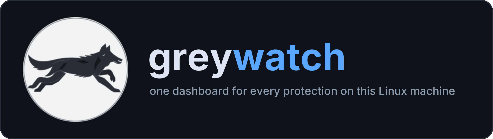
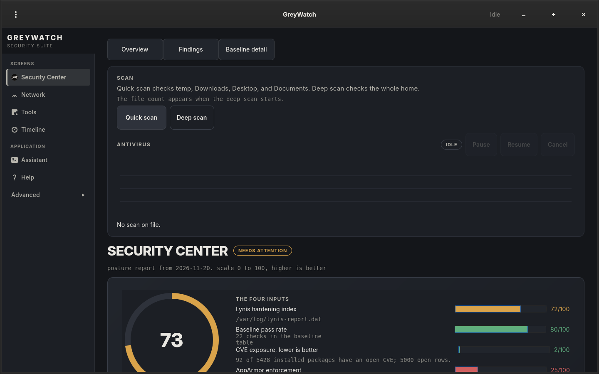
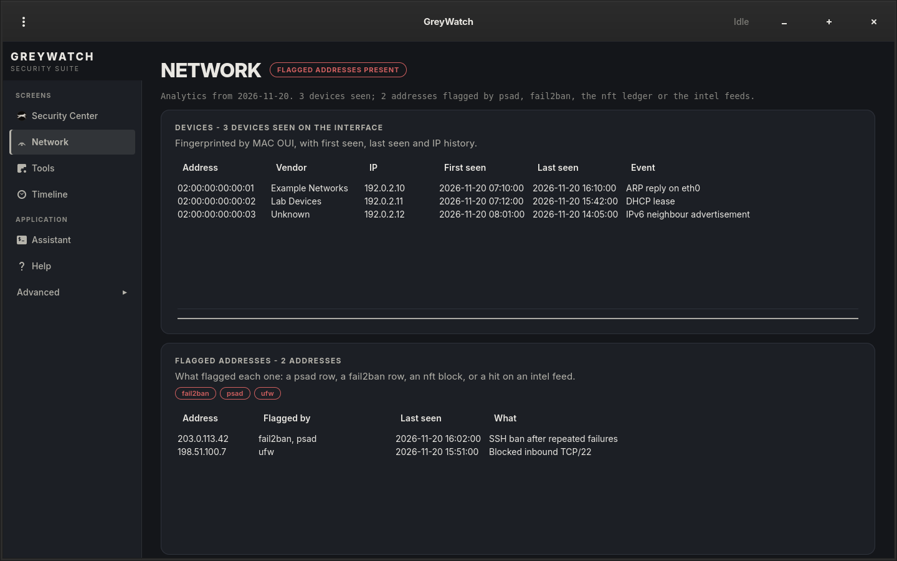
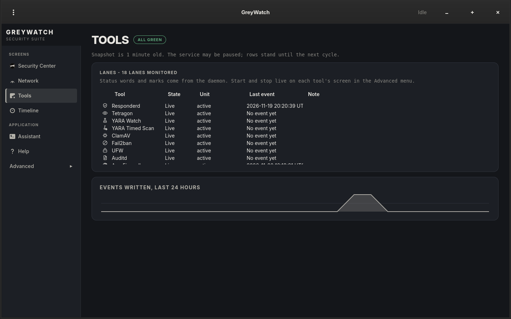
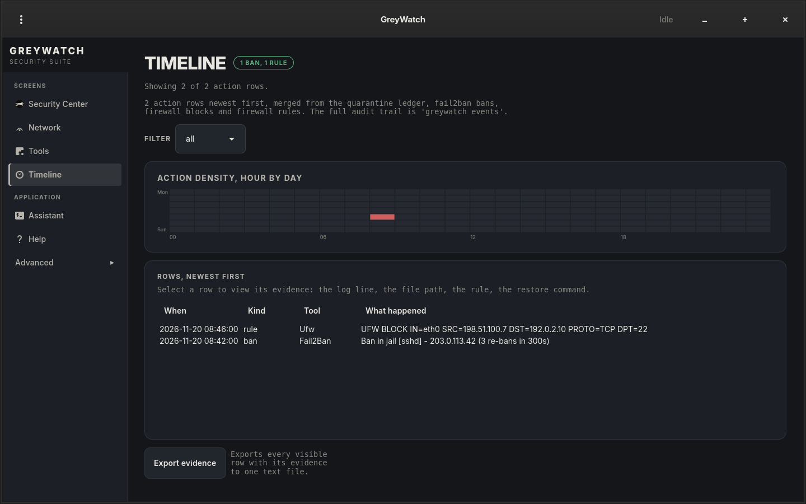
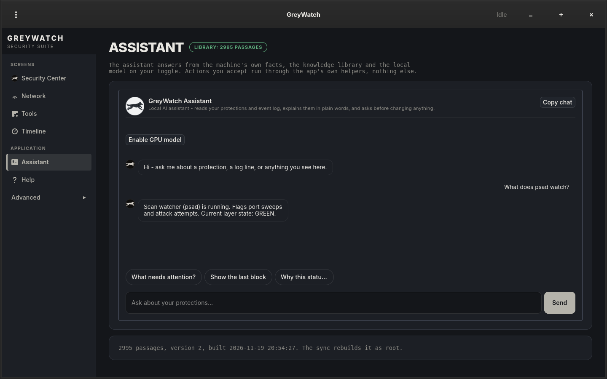
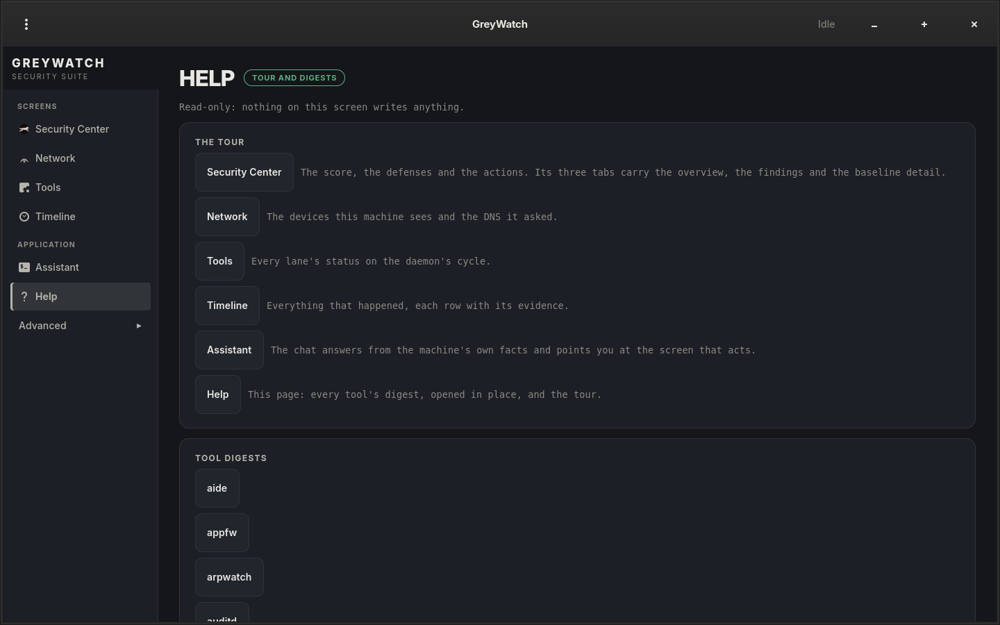
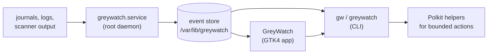

<div align="center">



# GreyWatch

**The security tools already on your Linux desktop, in one place.**

A small system service watches the logs, a command-line client reads the same
state, and a GTK4 window puts the whole picture on screen — without sending
anything to a cloud account.

[](pyproject.toml)
[](LICENSE)
[](pyproject.toml)
[](https://github.com/greyok00/greywatch/actions)

[Quick start](#quick-start) · [Screenshots](#screenshots) · [How it works](#how-it-works) · [CLI](#command-line) · [Install](#installation) · [Privacy](#privacy)

</div>

---

GreyWatch is a desktop security dashboard for Debian-based Linux systems. It
collects the scanners and protections that are already installed — ClamAV,
Lynis, rkhunter, AIDE, UFW, fail2ban, psad, auditd, AppArmor, YARA and a few
others — and turns their output into one understandable event stream.

It is three pieces of one system:

- a **background service** that reads journals and log files and writes an
  append-only event store;
- a **CLI** (`gw`, also installed as `greywatch`) that reads that store and
  performs bounded actions;
- a **GTK4 desktop app** that is a read-only view of the same store, with
  one-click hand-offs for the actions the CLI already supports.

The window never needs root. The service owns the privileged collection work,
and anything that changes the machine goes through the existing Polkit helper
path rather than through the GUI.

## Screenshots

The screenshots use a synthetic demo dataset. They show the layout and the
kind of information each screen carries; they are not taken from a real
machine.

| Security Center | Network |
| :---: | :---: |
|  |  |

| Tools | Timeline |
| :---: | :---: |
|  |  |

| Assistant | Help |
| :---: | :---: |
|  |  |

## What each screen does

### Security Center

The landing page. It answers the first question — *is anything wrong?* — with a
posture score built from four inputs: the Lynis hardening index, the baseline
pass rate, CVE exposure, and AppArmor enforcement. Below the score are the
five protection cards (virus, firewall, program control, integrity, updates)
and the scan desk.

Three tabs keep the detail out of the way until it is needed:

- **Overview** — score, inputs, scan controls and protection cards.
- **Findings** — open scan and configuration findings.
- **Baseline detail** — the stored baseline, check by check.

### Network

The devices this machine has seen, fingerprinted by MAC address and sorted by
last activity. The page also lists addresses flagged by psad, fail2ban, the
nftables block ledger or the intel feeds, and the DNS lookups made through the
local resolver. The page builds from the app's own records; it does not scan
the network itself.

GreyWatch also has a passive, host-local inbound sensor. It watches new
TCP/UDP packets and invalid TCP packets addressed to **this machine**, alerts
on fast, slow and stealth sweeps, and temporarily blocks external sources
after detection.
Private/LAN sources alert but are never auto-blocked; external IPv4 and IPv6
sources are eligible for a temporary block. Seeing sweeps against
*other* LAN devices requires a router/SPAN tap or an agent on each device; the
host process cannot see switched unicast traffic it is not part of.

#### Web of trust

Rather than trusting any single blocklist, the feeds lane pulls thirteen public
threat lists — StevenBlack, two Hagezi lists, OISD, 1Hosts, abuse.ch URLhaus,
Spamhaus DROP, DShield, CINS Army, FireHOL Level 1, Phishing Army, OpenPhish
and blocklist.de — and grades each one by how independently it is curated.
First-tier curators block on their own; entries from second-tier lists count
only when a second, independent source names the same host or netblock
(FireHOL, for example, only republishes several of the first-tier lists, so it
never corroborates them).

Rows that pass corroboration land in two enforcement layers: a dnsmasq
blocklist that answers the local resolver's domain lookups, and a dedicated
nftables table that drops traffic to and from listed netblocks, re-applied by
the service at every boot. The Network page reports, per feed, how many rows
were enforced and how many were held back pending corroboration. The blocklists
are refreshed by a systemd timer; a feed that fails to download or parse is
reported in place rather than silently dropped.

### Tools

One row per monitored lane: tool name, current state, systemd unit, last event
and a short note. The **Advanced** submenu opens the per-tool desk, where the
tool can be started, stopped or restarted and its configuration edited with a
backup of the previous file. A configuration that is rewritten by an upstream
daemon can be re-asserted from the same desk.

### Timeline

The investigation view. It merges quarantine entries, fail2ban bans, firewall
blocks and firewall rules into one newest-first chronology. Selecting a row
shows the evidence — the log line, the file path, the rule or the restore
command — and the visible rows can be exported as one text file. The complete
audit trail remains available through `gw events`.

### Assistant

A local question-and-answer surface. It starts with the deterministic advice
engine and the bundled tool digests, so common questions about a protection or
a log line are answered without a model. The optional resident GPU model is
off by default and is loaded only when the owner turns it on. There is no
cloud call, no account and no telemetry.

### Help

The same guided tour on demand, plus the tool digest library. Each digest
explains what a tool really watches, what its warnings mean and where its
configuration lives. The Help screen is read-only.

Appearance (dark or light) is a small header menu, not a separate screen.

## How it works



The service is the only long-running collector. It tails the systemd journal
and the files owned by each tool, normalizes every line into a structured
event, and appends it to the event store. Status snapshots, posture inputs,
scan state and the network analytics are written beside the event log.

The CLI is the product's API. It reads the same store, prints human-readable
output or JSON (`--json`), and is the seam the desktop app calls. The GUI does
not invent data paths and does not write state through a side door.

The GUI is a thin GTK4 skin over the CLI. It stays useful when the daemon is
stopped — the last snapshot is still there — and it never asks for a password
to display a page. Actions that need privilege are delegated to the existing
helper scripts and Polkit policy.

### Service layout

The installed service is `greywatch.service`. Companion timers and units cover
the slower work: CVE refresh, the threat-feed refresh, the watchdog, the boot
sweep, ClamAV scans and the threat hunter. Runtime state lives in `/var/lib/greywatch`; the program
lives in `/opt/greywatch` for the Debian package, or `/usr/lib/greywatch` for a
checkout install.

## Quick start

Build the Debian package from a checkout and install it:

```bash
git clone https://github.com/greyok00/greywatch.git
cd greywatch
./packaging/build-deb.sh
sudo apt install ./dist/greywatch_0.4.5.7_amd64.deb
```

Open GreyWatch from the application menu. From a checkout, start the window
with:

```bash
./ui/launch.sh
```

Check the service and the first snapshot:

```bash
systemctl status greywatch
gw status
```

For a full-system checkout install instead of a package:

```bash
sudo ./install.sh
sudo ./install.sh --check
```

## Command line

The CLI has two entry points for the same code: `gw` (the packaged console
script) and `greywatch` (the installed service command). Run `gw --help` for
the full list.

```bash
gw --version                       # installed version
gw status                          # what the suite is doing now
gw events --last 20                # newest events, newest first
gw events --tool psad --severity HIGH
gw tools                           # every monitored tool
gw tool psad                       # one tool, its unit and its lines
gw decisions --pending             # questions waiting for an answer
gw answer ID OPTION                # answer one decision
gw run                             # run every detector once
gw scan                            # inspect, pause, resume or cancel the scan
gw ask "what does psad watch?"     # local knowledge answer
gw assist "why is the firewall red?"
gw hunter                          # threat-hunt findings
gw doctor                          # diagnose, recover and verify
gw setup                           # first-install tool audit
```

All arguments are validated. IP addresses, jail names and unit names are
checked against fixed shapes or allowlists. Unknown commands and invalid
arguments exit with status 2 and a usage line. Privileged actions are routed
through `pkexec` helpers rather than performed by the CLI process itself.

## Installation

### Debian package

`./packaging/build-deb.sh` assembles the same tree that `install.sh` would
install, fills the systemd units and the Polkit policy, and writes a package to
`dist/`. The package installs under `/opt/greywatch`, enables
`greywatch.service`, binds the service to the desktop account and adds the menu
entry. Removing the package keeps `/var/lib/greywatch` intact.

Runtime dependencies are system packages: Python 3.12+, PyGObject, GTK4,
systemd and the firewall's small C helper toolchain. There are no pip runtime
dependencies.

### Checkout install

```bash
git clone https://github.com/greyok00/greywatch.git
cd greywatch
sudo ./install.sh
sudo ./install.sh --check
```

### Wheel

The Python sources can also be packaged as a wheel with
`./packaging/build-wheel.sh`; that wheel exposes the `gw` console command and
is useful when only the CLI is wanted.

## Build and test

```bash
python3 -m pytest tests/ -q
ruff check .
./packaging/build-deb.sh
```

The test suite includes headless GTK tests on a private Xvfb display. The
visual tests in `tests/test_e6_visual_baselines.py` compare rendered pages
against approved baseline images.

## Privacy

Everything stays on the machine. There is no cloud service, no account and no
telemetry. The event store is root-owned; the desktop app reads it as the
desktop user. The optional local model is loaded in-process only when enabled.
The assistant and the CLI answer from local logs and the bundled digests.

## Credits

- The bundled world map is derived from the public-domain [Natural Earth](https://www.naturalearthdata.com/) land map.
- All other code and assets are original to this repository.

## License

Apache-2.0. See [LICENSE](LICENSE).

Source, issues and releases: [github.com/greyok00/greywatch](https://github.com/greyok00/greywatch).
