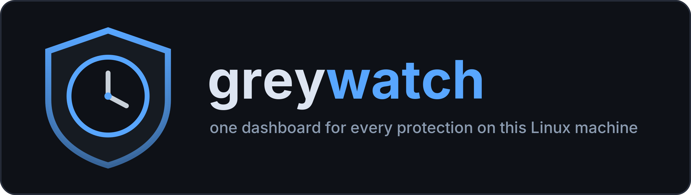

<div align="center">
  
  <p><b>greywatch</b> — A local watch-and-harden suite for Debian-class
  Linux desktops: watch the machine, record what happened, and preview
  reversible hardening before applying it.</p>
  <p>greywatch runs on your machine, not in a cloud dashboard. A root
  daemon collects security events, a dependency-free Python CLI explains
  them, and a GTK desktop app provides protection controls, scans, and
  guided hardening.</p>
  <p>The design is deliberately calm: a tray icon, desktop popups off by
  default, explicit unknown states, and no pretend-success messages.</p>
  <p><a href="#architecture">Architecture</a> ·
     <a href="#desktop-screens">Desktop screens</a> ·
     <a href="#scans">Scans</a> ·
     <a href="#application-firewall">Application firewall</a> ·
     <a href="#installation-and-removal">Installation and removal</a> ·
     <a href="#cli">CLI</a> ·
     <a href="#security-model">Security model</a> ·
     <a href="#faq">FAQ</a></p>
</div>

```text
greywatch status — updated 2026-10-26T09:06:20+00:00
🟢 aide          GREEN  — AIDE (integrity check)
🟢 appfw         GREEN  — App Firewall
🟢 arpwatch      GREEN   last:2026-10-25 — Arpwatch (ARP monitor)
🟢 clamav        GREEN   last:2026-10-26T06:54 — ClamAV (antivirus)
🟢 fail2ban      GREEN  — Fail2ban (bans)
🟢 ufw           GREEN  — UFW (firewall)
🟢 yara-watch    GREEN  — YARA Watch (realtime scanner)
🟢 … every row has the same shape: dot, tool, state, last activity
```

## What it watches

**Watch.** Follow activity on the local machine: processes, new binaries,
listening ports, systemd unit changes, and policy changes. The root daemon
combines inotify filesystem watchers with journal followers. It also
monitors the health of its own units.

**Record.** Write observations to an append-only event store and record
decisions separately: what was changed or allowed, and why. The event
store is root-owned with mode 0600, keeping its contents out of reach of
an ordinary compromised user session.

**Harden.** Run baseline checks without changing the system. Review
proposed changes before applying them. Hardening steps have an undo path,
and privileged operations go through designated helpers rather than
loosely constructed shell commands.

The daemon's systemd unit carries `CPUQuota=50%` and `MemoryMax=768M`
(raised from the original 10%/200M after a documented connection-storm
lockup). These bound the service's resource use; they are not a promise that every
scan engine has the same limits or that every operation completes
instantly.

### Event-store access is intentionally restricted

The event store is root-owned and mode 0600. An ordinary user session
cannot read or rewrite that file. Consequently, a GUI without the
necessary access can encounter an unreadable store. It must display that
access failure explicitly — not show an empty history and imply that
nothing happened.

An unreadable store and an empty store are different states. A lack of
visible events is not evidence of a clean machine.

### Rules, enrichment, and self-checks

Collectors, enrichment, and parsers feed the event store. A
registry-driven rules engine uses `registry.json` and `rules.py`. The
doctor self-check helps inspect greywatch's own condition — run
`python3 cli.py doctor`.

Protections are annotated in `nist-map.json` with the NIST 800-53 control
objectives they support:

| Control | Mapping focus |
|---|---|
| AC-3, AC-4, AC-7 | access-control objectives: least privilege, information-flow separation, failed-logon handling |
| CM-6, CM-7 | baseline configuration and least functionality |
| SI-2, SI-3, SI-4, SI-7 | flaw remediation, malicious-code protection, monitoring, integrity |
| SC-7 | boundary protection |

These annotations explain the purpose of a protection; they are not a
certification or a claim that installing greywatch makes a machine
compliant.

## Architecture

| Layer | Responsibility | Main components |
|---|---|---|
| L1 — root daemon | Collect, record, and supervise | `greywatch.service`, inotify watchers, journal followers, event store, decision records, unit self-watch |
| L2 — CLI | Inspect state and explain activity | Python standard library; `status`, `events`, `tail`, `log`, `decisions`, `rules`, `answer` |
| L3 — desktop GUI | Control protections, run scans, and guide hardening | GTK 4, PyGObject, dark/light themes, separate AyatanaAppIndicator3 tray helper |
| App Firewall | Per-process outbound control inside the daemon | `appfw/` engine, one nftables table, one NFQUEUE chain |

Every decision — suite-native or appfw intercept — flows through one
pipeline: specs → one answer per event (`data/decisions.jsonl`) → an
allowlisted helper script via `pkexec`. Only scripts listed in the
installed polkit policy can be privileged, and each is pinned to exactly
one helper path.

## Desktop screens

No product screenshots are embedded yet — the images in this README are
generated artwork, and the real screens land here before release. In the
meantime, [doc/help.html](doc/help.html) walks every screen in text with
a ten-question FAQ, and the same text lives in the app's Help tab.

**Security.** The home screen presents all 17 local protections as live
rows with state, last activity, and Pause/Resume controls where a real
unit backs them. Green means running, amber means paused, and red calls
for attention. A check that cannot be verified reports that uncertainty
rather than inventing a healthy state.

**Tools.** Per-protection cards provide Pause, Resume, Details, and
Scan now controls where applicable. A scan strip launches the five scan
types below. Work runs in the background and results appear in place.
Long scans remain pending until they finish; users can wait or check
later. Updater rows show actual freshness, such as when the update list
was fetched or virus definitions were updated — a running service alone
is not presented as evidence that its data is fresh.

**Harden.** Run read-only baseline checks, inspect proposed hardening
steps, and review the full preview before applying changes. Reversible
steps include an undo path. Every touched file is backed up and journaled
before the change, and **Undo last change** reverts it.

**Settings.** Choose dark or light appearance, explicitly enable desktop
popups (off by default), manage application-firewall switches, maintain
trusted sites, start time-boxed learning mode, and refresh updater lists.
Popups are off by default; the tray remains the quiet surface.

**Logs.** Filter by tool and inspect recorded activity. If the event
store cannot be read, the screen explains the access problem. It does not
substitute a fake empty table.

**Setup Wizard.** A six-step onboarding flow (`welcome` → `scan` →
`preview` → `apply` → `verify` → `finish`) probes the machine's role,
builds an adaptive hardening plan, previews it step by step, then applies
approved changes and verifies the result. Role probes inspect what is
installed, listening, or exposed.

Two companion flows extend this setup:

- **Tool Chooser** — add a custom protection from the catalog.
- **Per-tool wizards** — author a tool's rules through a guided
  conversation instead of editing a configuration file by hand.

## Scans

The Tools screen exposes five scans, driven through the protections the
machine already has:

| Scan | Engine | Purpose |
|---|---|---|
| Quick scan | YARA | Sweep temporary folders with YARA rules |
| Full antivirus scan | ClamAV | Run an antivirus scan with the ClamAV engine |
| Rootkit scan | rkhunter | Check for rootkit indicators |
| Security audit | lynis | Inspect security configuration and hardening opportunities |
| File-integrity check | aide | Compare files against an integrity baseline |

They serve different purposes: a temporary-folder sweep is not a full
antivirus scan, a rootkit check is not an integrity baseline, and an
audit is not a malware verdict. Scans run in the background. Results
appear in place after completion. An unfinished scan is not a clean
result, and a tool that cannot be checked must be reported as such.

## Application firewall

The application firewall is off by default (the daemon's status reports
`appfw: off (owner switch)` until armed) and designed to fail open: if
its daemon dies, traffic flows rather than being left waiting for a
userspace verdict.

Arming is a deliberate owner act in the app, and requires
`netfilterqueue` plus libnetfilter-queue headers — without them the
engine refuses to arm and nothing else on the machine changes. When
armed, it installs its own nftables table (never the system firewall's)
and decides every NEW outbound connection through one chain: trusted
site → trusted program → permitted local services → downloaded block
list → learning mode → block-unknown → explicit ask → default
allow-once (fail-open).

It provides:

- Learning mode for observing application behavior (time-boxed: the
  window is an explicit `until` timestamp, checked against the clock).
- A strict block-unknown mode.
- Workspace-aware profiles, managed in Settings.
- A prominent pause/resume switch.

Fail-open behavior is an availability choice, not a claim that blocking
continues after a daemon failure. While the engine is unavailable,
greywatch's application-level enforcement is unavailable too. Other
system firewall rules remain a separate concern — the engine can never
lock your traffic out, and it never touches the system firewall's rules.

## Installation and removal

Requirements:

| Component | Requirement |
|---|---|
| Host | Debian-class Linux with systemd; developed and run on a MATE desktop (any indicator-compatible panel works for the tray) |
| CLI | Python 3.12+; no third-party Python dependencies for the CLI |
| Desktop GUI | GTK 4 and Python PyGObject |
| Tray integration | AyatanaAppIndicator3, hosted in a separate helper process |
| Privileged hardening | polkit and pkexec, with the project's exact-helper allowlist |
| Scan integrations | YARA, ClamAV, rkhunter, lynis, and aide, as used by the selected protections |
| Optional application firewall | nftables, NFQUEUE support, and Python netfilterqueue |

Install:

```bash
sudo ./install.sh      # system files + service restart + user icons
./install.sh --check   # verify the deployment (no root needed)
```

`install.sh` is one short script — read it before granting it root. It
substitutes this checkout's path into the hardened unit
(`doc/greywatch.service`) and the polkit allowlist
(`apply/polkit/greywatch.apply.policy`), installs both, reloads systemd,
enables and restarts the service, and installs the user icons and
launcher. Without sudo it installs only the icons and launcher. Self-test
without touching the system: `./install.sh --root <dir>` then
`./install.sh --check --root <dir>` — the same flow
`tests/test_install_script.py` exercises in the battery.

After installation, inspect the resulting state:

```bash
python3 cli.py status
```

Then open the desktop app and review the Setup Wizard's probes and plan
before approving any hardening. The application firewall starts off;
desktop popups also start off.

Remove — the installer reverses itself, but deliberately keeps `data/`:

```bash
sudo ./install.sh --uninstall
```

It removes the unit, the polkit allowlist, and the user-scope launcher
and icons. Security history in `data/` is kept unless you delete it
yourself — decide what you want done with that history before removing
the suite.

### Configuration

There is nothing to configure before first run, and no credentials to
enter anywhere — the suite drives your machine's own tools. The only
names the code consults:

| Name | Who reads it | What it does |
|---|---|---|
| `GREYWATCH_UI_USER` | daemon | user account the GUI relaunches under |
| `GREYWATCH_USER_HOME` | registry | alternate HOME for runtime state |
| `GREYWATCH_HELPER_CMD` | tests | test-only helper override; never set on a real machine |
| `NOTIFY_SOCKET` | appfw engine | set by systemd for Type=notify |
| `data/` tree | everything | runtime state, root-owned, never shipped |

## CLI

The CLI uses the Python standard library. Six commands inspect the
machine, `answer` records a decision on a pending interaction, and
three utilities take care of setup and maintenance:

| Command | Purpose | Example |
|---|---|---|
| status | Inspect current protection state | `python3 cli.py status` |
| events | Inspect recorded observations | `python3 cli.py events` |
| tail | Follow incoming event activity | `python3 cli.py tail` |
| log | Inspect log output | `python3 cli.py log` |
| decisions | Inspect what was changed or allowed, and why | `python3 cli.py decisions` |
| rules | Inspect rules | `python3 cli.py rules` |
| answer | Record your decision on one pending interaction (answer-once is enforced; the chosen helper then runs via pkexec) | `python3 cli.py answer ID OPTION` |
| doctor | Self-check greywatch's own condition | `python3 cli.py doctor` |
| setup | First-time service setup from the CLI | `python3 cli.py setup` |
| action | Maintenance actions (daemon restart) | `python3 cli.py action restart` |

Start with `status` for the health table, then use the other commands to
inspect the underlying activity and decisions. Commands that need
protected records remain subject to the event store's access
restrictions (root only).

## Security model

Three honesty guarantees:

- **Unknown stays unknown.** A probe that cannot be verified says
  "could not be checked." It does not guess or fake a green dot.
- **Timeouts stay timeouts.** If the pkexec password prompt reaches the
  application's 30-second timeout, the action reports that timeout
  rather than claiming success.
- **Unreadable stays unreadable.** An inaccessible root-owned store
  produces an explicit access message, not a table pretending the
  history is empty.

These are interface guarantees as much as implementation rules. A calm
interface must still be truthful.

**Privilege boundaries.** The daemon runs as root. The desktop app
provides the interface. Privileged changes go through pkexec using a
polkit allowlist of exact helper paths. The allowed helper boundary is
explicit; the GUI is not a generic shell-command execution surface.

**Record integrity and limitations.** The store is append-only by
application design and protected from ordinary user access by root
ownership and mode 0600. Decision records preserve what changed and why.
This is tamper resistance against an ordinary user-session compromise,
not a claim of root-proof or cryptographically immutable logging. Mode
0600 alone does not establish a kernel-enforced append-only flag, and a
root-owned local record must not be advertised as proof against a fully
compromised host.

**Preview and recovery.** Baseline checks can run read-only. Hardening
changes are previewed before application and have an undo path. A plan
proposed by the Setup Wizard is not permission to apply every step
without review.

**Honest limitations.**

- The engine's process resolution is /proc-based (no eBPF): rare
  connection bursts may see brief resolve misses that fall back to
  allow-once; the queue rule's `bypass` guarantees a dead engine can
  never lock traffic out.
- Reverse DNS fills `dst_host` best-effort so site trust applies; an
  unresolvable IP decides on IP/path rules only, never on a guess.
- Truncate + same-length rewrite fully inside one 50 ms poll is
  undetectable by content-free means (GNU tail -F shares this).
- Disk encryption is ignored entirely by this build — never probed,
  never touched.
- Single-ban fail2ban events do not ask for decisions — only
  near-ignoreip patterns (3+ re-bans of one IP inside 300 s) do.

## Testing and project health

The test battery is the ground truth, and the invocation is the real
one this tree is shipped with:

```bash
env -u DISPLAY python3 -m pytest -q tests/   # 585 tests, ~50 s
```

As of 2026-10-26 that battery passes 585 tests and skips 4
display-dependent GUI tests (with a real display they run). The copy
rules are executable (`runbooks/longtext.py` flags user-facing strings
over 12 words), wizard flows are tested end-to-end with fakes, the
theme system round-trips, and the GUI has a smoke suite. The Harden
path is unit-tested never to escalate privileges by itself.

CI runs lint and the same battery on every push; a CI badge will be
added once the repository is live and has real runs to point at.

## FAQ

**Can it lock me out of the network?**
The application firewall starts off and is designed to fail open if its
daemon dies. Its purpose is to avoid accidental loss of connectivity
from a missing queue consumer. That does not guarantee connectivity
under unrelated network failures, other firewall rules, or every policy
you deliberately enable. Review strict block-unknown mode before using
it.

**Does the GUI pretend an unreadable store is empty?**
No. It reports that it cannot read the store. An access error, an empty
history, and an unknown check result are distinct states.

**What does a paused protection mean?**
That protection is paused rather than running. Security shows its state
and provides a resume control; Tools exposes the corresponding
protection controls. Paused is not the same as healthy, and it is not
the same as a completed scan.

**How much CPU and memory does the daemon get?**
The daemon's unit carries CPUQuota=50% and MemoryMax=768M. Those are
service resource limits, not a speed guarantee for scans or a statement
that every external scanner belongs to the same capped service.

**Will it interrupt me with popups?**
Not by default. The tray is the calm status surface. Desktop popups
must be explicitly enabled in Settings.

**Does it send security history to a cloud service?**
No. greywatch has no cloud component; observations and decisions stay
on the machine. Local operation does not mean that tools which refresh
update lists or antivirus definitions never make network connections.

**Does a NIST control mapping make this a compliance product?**
No. The mapping explains which control objectives a protection
supports. It is not a certification, a compliance assessment, or proof
that the host satisfies those controls.

**Can I preview and undo hardening?**
Yes. The hardening workflow previews steps before application and
provides an undo path. Read the proposed changes and their scope before
approving privileged work.

**What happens when authorization times out?**
The application reports that the pkexec password prompt timed out after
30 seconds. It does not claim the action succeeded.

**Are the images actual screenshots?**
No — the banner and icons are generated artwork. Real desktop
screenshots are added before release; nothing in this README pretends
otherwise.

## License

Apache License 2.0 — see [LICENSE](LICENSE). Contributions land under
the same terms ([CONTRIBUTING.md](CONTRIBUTING.md) is the front door),
and [ACCEPTABLE_USE.md](ACCEPTABLE_USE.md) is the boundary: defensive
use on machines you own or are authorized to administer, nothing else.

### Free vs premium

Everything in this repository is free and stays free — daemon, CLI, GTK
app, and the tagged release bundles. A future premium tier lives in a
separate private repo: the free core is never a trial of it, and
payment, license-check, and webhook secrets have no place in this tree
— pre-commit and CI run gitleaks on every push to keep it that way.

## Roadmap

- **v0.1.x** — documentation polish: real desktop screenshots before the
  public release.
- **v0.2** — packaging: a `.deb` that installs units + pkexec policy in
  one step.
- **premium (separate repo)** — hosted summaries and extra profiles;
  the free core is untouched by it.

<div align="center">
  
  <br>
  <sub>greywatch — the wolf runs the perimeter: protections you can see, changes you can undo.</sub>
</div>