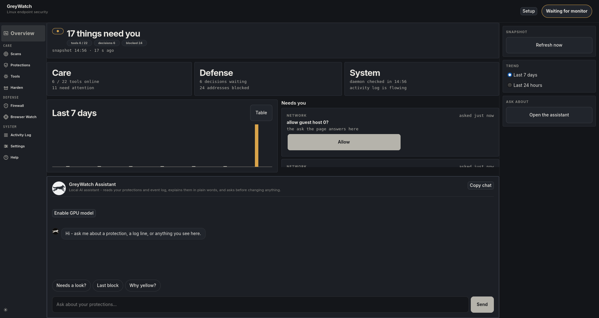
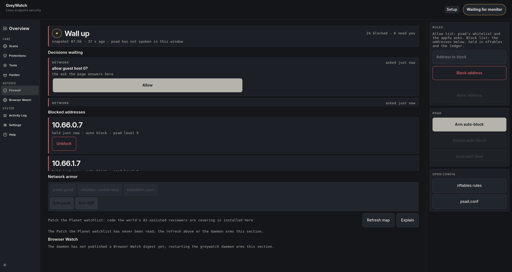
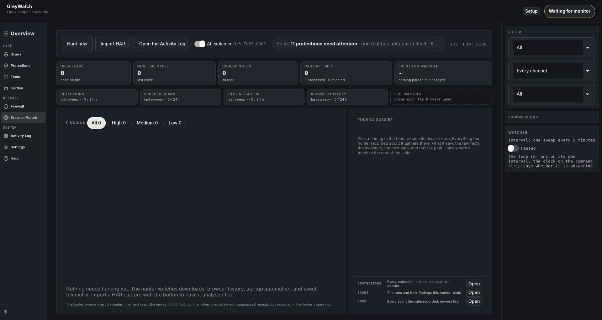
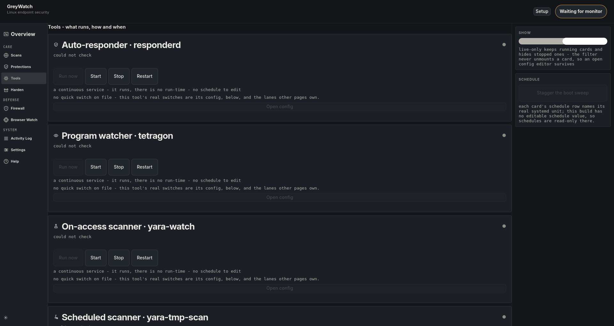
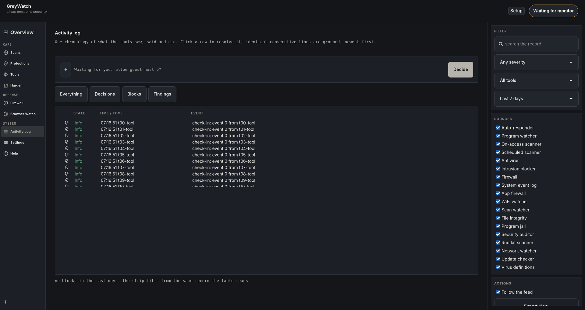
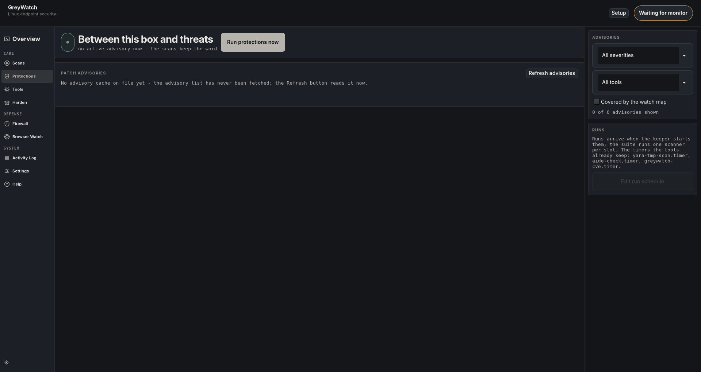
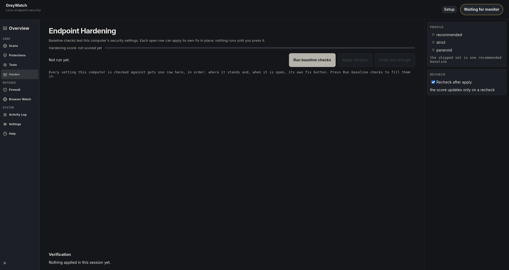
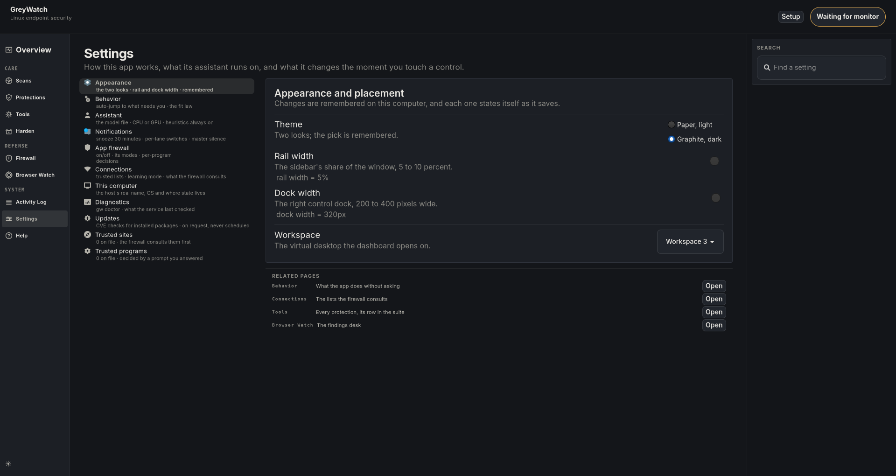

<div align="center">
  

  **One window for every protection already on your Linux desktop.**

  [](LICENSE)
  [](https://github.com/greyok00/greywatch/releases)
  [](pyproject.toml)
  [](#build-and-test)
  [](https://github.com/greyok00/greywatch/actions)
</div>

---

## What is GreyWatch?

GreyWatch collects the security tools already installed on a Debian-based desktop (antivirus, rootkit scanner, integrity check, firewall, audit and more) into one window. It runs their scans in order, parses every log line into a structured event, and shows the verdict a person can act on. A root daemon tails each tool's journal and log files and writes an append-only event store; the GTK4 desktop app and the `gw` command-line tool are read-only clients of that store, so the window never needs root and no scan asks for your password.

## What you get

The window is one thin rail, always visible, with every page one click away:

- **Overview** - what happened, the trend, and the "Needs you" rows.
- **Care** - Scans, Protections, Tools and Harden, the maintenance desk.
- **Defense** - Firewall and Browser Watch (the threat hunter's findings).
- **System** - Activity Log, Settings and Help.

Every page owns a control dock on the right: the filters, feeds and actions that page actually answers, so nothing important hides behind a right-click. The app walks you to what needs attention: the row that matters pulses, and hand-off navigation leaves a "came from" breadcrumb on the page it opened, with a way back. Every row resolves in one click: delete the record it flagged, update the baseline that froze it, or make the verdict permanent (Allow or Block, saved where the tool will honor it).

<div align="center">
  
</div>

The Overview is the digest: the "Needs you" count up front, one health card per rail group, the Last 7 days trend and the assistant's plain-language read of the log.

**Tools** shows every managed tool as one card: run/stop/restart controls, the truthful schedule and throttle text ("no quick switch on file: this tool's real switches are its config"), and the card's own config editor - validated, with a backup written before the first write and the file's mode preserved. A config that keeps reverting (upstream daemons rewrite settings) has the permafix loop: the baseline is re-asserted after the tool itself rewrites it.

**Protections** is the one page for what is active right now: state, the next scheduled runs, and the patch advisories wall (the CVE cache for what you run, refreshed on demand).

**Harden** checks the machine against its hardening baseline: one bar for the score, the flat checklist in the machine's own words, and every change applied only after you press it, with undo.

**Firewall** is the app firewall: per-program allow/deny over nftables and NFQUEUE, ask-first prompts, learning mode, and the auto-block desk (arm, disarm, unblock a held address) with the plain-text rule and config files one click away.

**Browser Watch** is the threat hunter's report: hunt cycles every few minutes over what is already on the machine (detections, finished scans, the Downloads folder, startup automation, browser history, imported HAR captures), findings in plain language with a suggested next step, handed back to the suite rather than acting on its own.

**Activity Log** is the record: one chronology, identical consecutive lines grouped, every row click-to-resolve, filters for severity, tool and window.

**Assistant** answers questions from your own logs: the deterministic advice engine comes first, and the optional resident local GPU model is off until you turn it on (the toggle is labeled; staged loading, unload the same way). No ollama, no cloud, no account - the model file runs in-process, or the window stays on heuristics. Tool digests (how each protection really behaves, distilled offline) sit behind the same answers.

<div align="center">
  
</div>

<div align="center">
  
</div>

First launch takes the guided walkthrough once (Stop tour in the header ends it); Help keeps the same tour on call.

| More shots | |
|---|---|
|  |  |
|  |  |
|  | |

## Install

The release page hosts the Debian package, the `gw` wheel and a checksum. The tree is open readable Python: the package ships `.py` sources (no compiled `.so` modules), so one deb fits every Python `>= 3.12` machine - build it on your own interpreter from a checkout:

```bash
git clone https://github.com/greyok00/greywatch.git
cd greywatch
./packaging/build-deb.sh      # -> dist/greywatch_0.4.0_amd64.deb
sudo apt install ./dist/greywatch_0.4.0_amd64.deb
```

Each release includes a `sha256` checksum. The package installs under `/opt/greywatch`, enables `greywatch.service`, binds the service to your desktop account and adds the menu entry. State (events, scans, logs) lives in `/var/lib/greywatch`; `sudo apt remove greywatch` keeps it. Nothing in `/var/lib/greywatch` needs to be migrated by hand between releases.

Runtime requirements are system packages, not pip installs: Python 3, PyGObject and GTK4 (the deb Depends declares them, plus gcc and libnetfilter-queue; the firewall verdict worker is tracked C source, `appfw/nfq_worker.c`, compiled once at first arm by `appfw/engine.py` - no prebuilt binary is shipped). The optional resident assistant model uses `llama-cpp-python`, an extra that stays installed out unless you ask for it.

For a full-system install from a checkout:

```bash
git clone https://github.com/greyok00/greywatch.git
cd greywatch
sudo ./install.sh          # installs under /usr/lib/greywatch
sudo ./install.sh --check  # verify
```

For the command line only, the wheel from a release gives you the `gw` command (`status`, `events`, `tail`, `log`, `decisions`, `answer`, `rules`, `hunter`, `doctor`, `action`, `setup` over the same store):

```bash
pip install https://github.com/greyok00/greywatch/releases/download/v0.4.0/greywatch-0.4.0-py3-none-any.whl
gw --version
```

## Build and test

```bash
python3 -m pytest tests/ -q     # 2134 passing on the plain sources
ruff check .
python3 packaging/build-wheel.sh    # py3-none-any wheel + `gw` entry point
```

## Credits

- The bundled world map in `assets/maps/world.png` is a crop of the [Natural Earth](https://www.naturalearthdata.com/) land map, which is public domain.
- All other code and assets are original to this repository.

## License

Apache 2.0. Source, issues and releases: [github.com/greyok00/greywatch](https://github.com/greyok00/greywatch).

Development: built with AI assistance and verified by tests and CI.

Privacy: everything stays on your computer. No cloud, no account, no telemetry; the event store is root-owned and the assistant answers from local logs.
