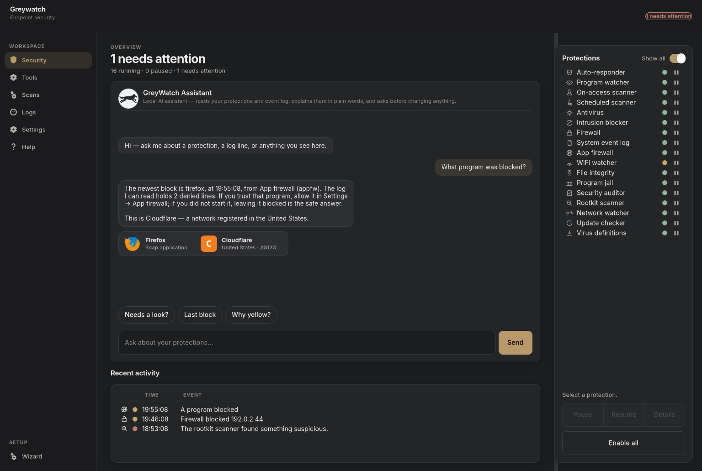
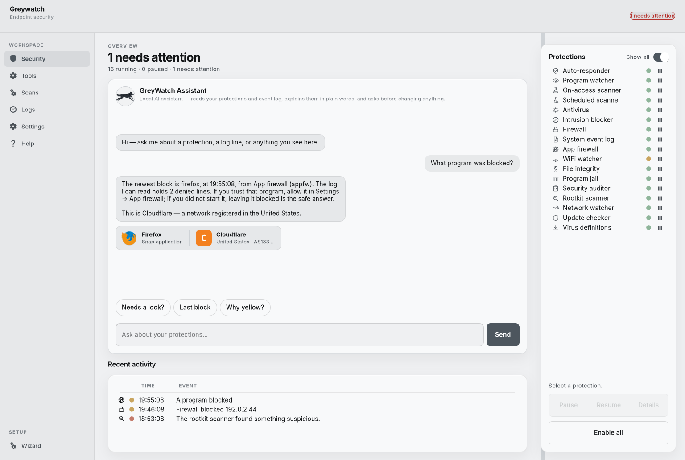
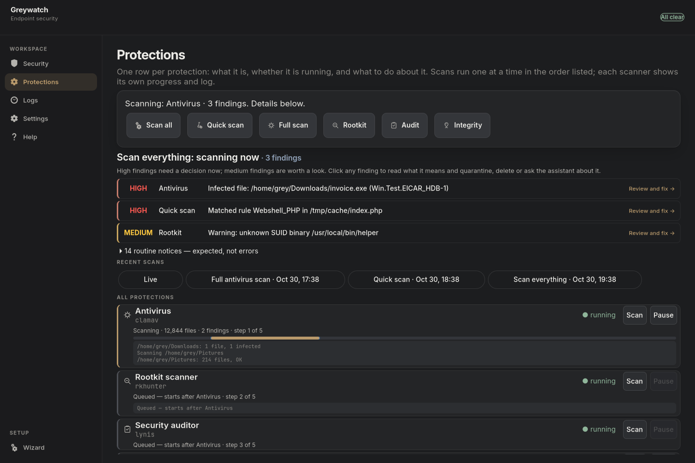
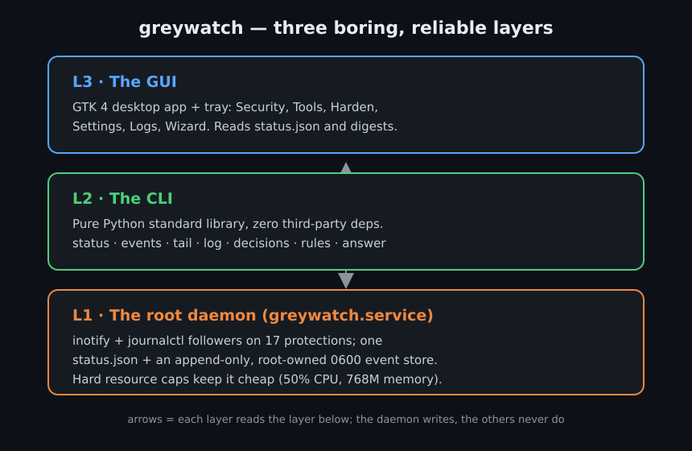

<div align="center">
  
  <p><b>greywatch</b> puts every endpoint protection on a Debian-based Linux
  desktop into one window, and adds an assistant that answers questions about
  what it saw. Everything runs on the machine it watches: no cloud, no
  account, no telemetry.</p>
</div>

<div align="center">
<table>
  <tr>
    <td></td>
    <td></td>
  </tr>
  <tr>
    <td align="center"><i>Dark theme</i></td>
    <td align="center"><i>Light theme</i></td>
  </tr>
</table>
</div>

## Ask it what happened

Type a question in plain words. The assistant reads this machine's own event
log, the same one the background service writes, and answers from it.

* **Grounded answers.** "What program was blocked?" names the newest block,
  the program, the time, and what the firewall decided — with the destination
  identified (Cloudflare, Amazon, Google…) and an evidence strip naming the
  program binary. Nothing is invented, and no lookup leaves the machine.
* **Advice, not just facts.** "How do I fix the rootkit scanner?" gives what
  the line means, why it matters, and numbered steps: copyable commands you
  run yourself, plus app actions that ask for confirmation first.
* **It can act, with a confirm gate.** Pause or resume a protection, start a
  scan, turn the app firewall on, open learning mode, update lists, trust or
  block a site, switch theme or page. Each action shows a confirm dialog and
  lands in `assistant-actions.jsonl` tagged `via=assistant`.
* **Local model, optional.** A Qwen3-1.7B model (~1.1 GB, CPU only, no port,
  thinking disabled) handles the wording that pattern matching can't. Without
  the model, every question above still gets a deterministic answer from the
  advice engine.

## Install

greywatch targets Debian-based Linux (Debian 12+, Ubuntu 24.04+, Mint 22+).
You need GTK4, PyGObject and systemd — the desktop stack a Debian install
already has.

**From the .deb (recommended):**

```bash
sudo apt install ./greywatch_0.1.5_amd64.deb
```

The package installs the root service, polkit policy, icons and launcher,
starts `greywatch.service`, and binds it to your desktop account. Then launch
**greywatch** from the applications menu, or:

```bash
python3 /usr/lib/greywatch/ui/app.py
```

**From a checkout:**

```bash
git clone https://github.com/greyok00/greywatch.git
cd greywatch
sudo ./install.sh
sudo ./install.sh --check     # verify the installed tree
python3 cli.py status
```

`install.sh` accepts `--root <dir>` to rehearse the whole install in a
throwaway tree, and `--uninstall` to reverse it while keeping your history.

**Wheel (CLI only):**

```bash
pip install https://github.com/greyok00/greywatch/releases/download/v0.1.5/greywatch-0.1.5-py3-none-any.whl
gw --version
gw status
```

The wheel ships the `gw` command and the same code; it does not install the
systemd units, polkit policy or icons. Use the .deb or `install.sh` for the
system-level install.

## What it watches

Seventeen protections, one registry. The app reads each one's state and logs,
runs its scans, and can pause or resume it — all without a terminal.

| In the app | Under it | What greywatch does with it |
|---|---|---|
| Antivirus | ClamAV | Runs full and quick scans, shows files scanned and any hit |
| Virus definitions | freshclam | Shows freshness; updates on request |
| Rootkit scanner | rkhunter | Runs rootkit scans, surfaces warnings and hidden files |
| Security auditor | Lynis | Runs the audit, lists warnings with their test IDs |
| File integrity | AIDE | Runs the integrity check, lists what changed since the baseline |
| On-access scanner | YARA Watch | Realtime scan of files as they are touched |
| Scheduled scanner | YARA temp scan | Sweeps `/tmp` and `/var/tmp` every 15 minutes |
| Firewall | UFW | Shows state and blocked-connection events |
| App firewall | greywatch's own | Per-program allow/deny for outbound and inbound traffic |
| Network watcher | greywatch's own | Light IDS on connection events |
| Intrusion blocker | fail2ban | Shows bans and unbans as events |
| Program jail | AppArmor | Shows policy denials (AVC) |
| System event log | auditd | Parses audit records, including crashes and exec events |
| Auto-responder | greywatch's own | Quarantines or kills a flagged process on request |
| Program watcher | Tetragon | Kernel eBPF process and network events |
| WiFi watcher | arpwatch | New devices and address changes on the LAN |
| Update checker | greywatch's own | Tracks CVEs for installed packages |

Six scans run on demand from the **Protections** page: Scan everything, Quick
scan, Full antivirus scan, Rootkit scan, Security audit, File-integrity check.
The root service runs them, so closing the window never loses a scan. They run
**one at a time, in the order listed** — each scanner is a separate systemd
unit, so a service restart no longer kills a running scan.

## The rest of the app

<div align="center">
  
</div>

The Protections page is the control room. Every protection gets one full-width
row with its live state, last scan result and a pause control. The five
scanners add a horizontal progress bar and the last lines the scanner itself
printed, and each row is edged in the colour of its scan state — blue while
working, grey while queued, green when finished, red when it needs a look.

Findings sit above the rows, newest first. Each one names the severity in
plain words, the tool that found it, and the file when there is one; click it
and you get what the line means, numbered steps, and **Quarantine** or
**Delete** for infected files (the helper asks for your password and refuses
system paths). Expected noise — baseline drift, package debris, tool
suggestions — folds into a "routine notices — expected, not errors" expander
so a real finding is never buried.

**Other features:**

* **App firewall.** An nftables/NFQUEUE engine watches traffic per program and
  asks before allowing a new connection. If a verdict times out or the worker
  stalls it **fails open**: traffic flows, the degradation is announced in
  status, and the health counters say why. Enforcement only starts when you
  arm it in the Setup Wizard.
* **Trusted sites and trusted programs.** Allow or block domains, programs or
  folders from Settings or from the assistant; the app firewall consults both.
* **Learning mode.** New connections pass once and are recorded, so you can see
  what a program needs before you allow it.
* **Setup Wizard.** Checks the machine against a hardening baseline, previews
  every change, applies them with one password prompt, then verifies or
  undoes. Nothing changes without your confirmation.
* **Logs.** Every event, newest first, filterable by tool, with severity and a
  plain-English rendering of the raw line.
* **Settings.** Appearance, app firewall, connections, this computer,
  diagnostics, updates, trusted sites, trusted programs.
* **Two themes.** Obsidian (dark) and Swiss (light) — a switch in Settings, or
  just ask the assistant.
* **CLI.** `gw status`, `gw events`, `gw tail`, `gw log`, `gw decisions`,
  `gw doctor` — the same store the desktop app reads.

## Architecture



A root daemon tails each managed tool's journal and log files, parses every
line into a structured event, and appends it to an `0600` append-only store.
It also runs the app firewall and publishes the status snapshot the UI reads.
The GTK4 app and the `gw` CLI are both read-only clients of that store: the
window never needs root, and no scan ever asks for your password.

## Security model

The program lives in root-owned `/usr/lib/greywatch`; runtime state lives in
`/var/lib/greywatch` (`0770`, root plus your desktop group). Root writes into
that shared directory go through a private staging dir with exclusive,
symlink-refusing creates and one atomic rename. Helper scripts run through a
polkit policy that allow-lists exact installed paths. The assistant has no
network access and executes nothing on its own — every command it offers is
text you run, and every action pauses at a confirm dialog.

Tests: `python3 -m pytest tests/ -q` (1128 passing, 2 skipped on machines
without the optional hardware). `ruff check .` is clean.

## About

greywatch is built and maintained by
[Randy Barham](https://www.randybarham.com). Source, issues and releases:
[github.com/greyok00/greywatch](https://github.com/greyok00/greywatch).
The software is free to run on your own machines; the event trail it writes
belongs to you.
