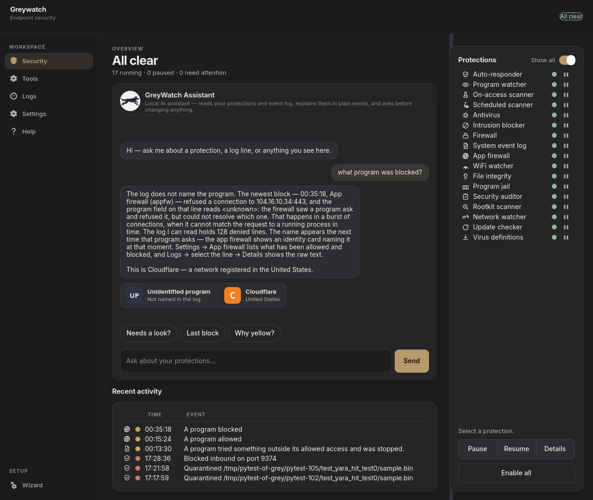
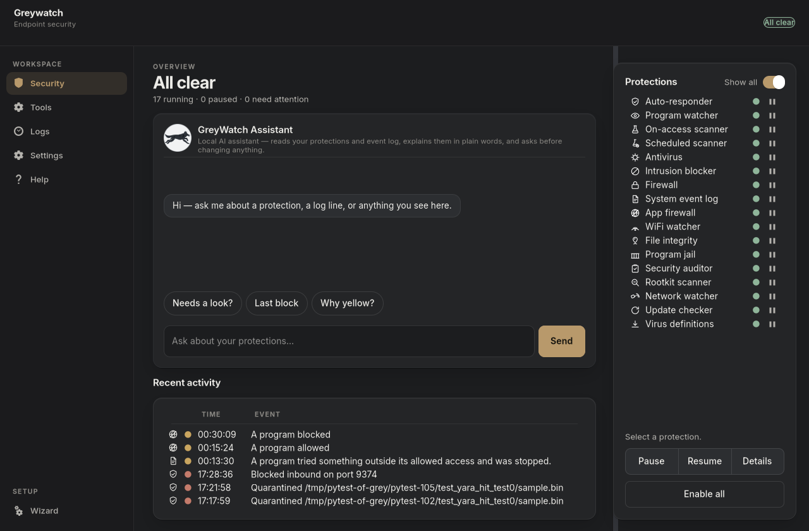
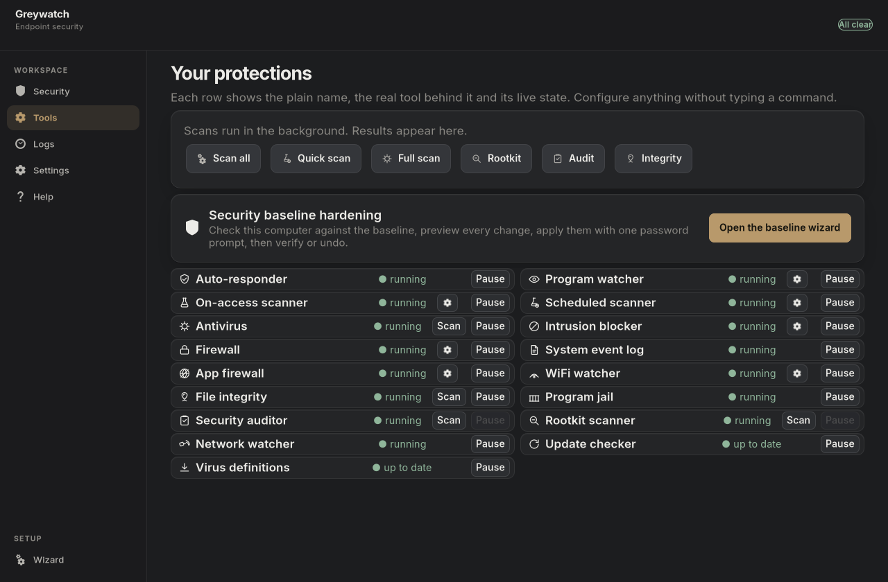

<div align="center">
  
  <p><b>greywatch</b> is an AI-enabled Linux endpoint security suite for the
  desktop. Every protection on the machine in one dashboard, an assistant
  that answers from your own logs. No cloud. No account. No telemetry.</p>
</div>

## What it is

greywatch watches the endpoint tools a serious Linux security setup
already relies on — antivirus, firewall, rootkit scanner, file integrity,
application firewall and more — and puts all of them, their scans, their
logs, and every decision they generate into a single desktop app.
What makes it AI-enabled is the assistant on that dashboard: ask a
question in plain words and it answers from your machine's real event
trail, explains the line, and walks you through the fix — while all of
it, including the model, runs locally.

<div align="center">
  
</div>

## The assistant

The chat panel is a grounded security analyst, not a chatbot. It reads
the same `0600` event store the daemon writes — nothing else, and no
network.

* **Real answers from real data.** "What program was blocked?" is
  answered from your logs, not invented: the newest block, the address,
  the program field, and what the firewall actually decided.
* **Who is it talking to?** Each answer carries a picture of the
  destination — a brand mark for known companies (Cloudflare, Amazon,
  Google…) or a geoip map tile of the country — plus an evidence strip
  in the app-firewall identity card naming the program. Everything is
  drawn locally; no lookups beyond your own logs.
* **Advice, not facts.** "How do I fix this?" runs a deterministic
  advice engine: what the line means, why it matters, and numbered
  steps — copyable commands you run yourself and app actions that show
  a confirm dialog first. Nothing is ever executed from chat.
* **A small brain, at home.** A local Qwen3-1.7B model (~1.1 GB, CPU
  only, no port, thinking disabled) handles the routing and summarizing
  that pattern matching can't. If it's missing, the chat falls back to
  docs-only mode and stays useful.
* **Audited.** Every action it proposes lands in
  `assistant-actions.jsonl` tagged `via=assistant`, alongside the
  decision the user confirmed.

## Features

* **Fail-open application firewall.** An nftables/NFQUEUE engine with a
  compiled worker watches outbound and inbound traffic per application.
  Verdict timeouts and worker stalls trigger a **fail-open** stop:
  traffic flows, the engine announces the degradation, and status shows
  the health counters — stability first, enforcement second. Arming is
  an explicit on-switch via the Setup Wizard; nothing enforces before
  you fire it. Headless `ask` rules default to **deny-once** — an
  unknown-program question you never answered blocks rather than
  silently allows; `allow-once` is the documented availability-first
  alternative, and whichever is live is labeled `NOT user-approved` in
  status.
* **Honesty guarantees.** The event store is append-only and `0600`.
  The status snapshot the GUI reads is NOT world-readable: it is
  written `0640` root plus your desktop group, and the machine's real
  failures are published in it (per-category failure counters and a
  `degraded` list) rather than silently swallowed. Headless fallback
  decisions are labeled in status as `NOT user-approved` — nothing is
  ever advertised as user-approved when it wasn't.
* **Secure code/state split.** The program is installed to
  root-owned `/usr/lib/greywatch` (verified free of other-writable
  files; the root daemon never executes from a user-writable checkout)
  and all runtime state lives in `/var/lib/greywatch` (`0770`, root
  and your desktop group only). Root writes to that shared directory
  land through a private root-only staging dir with exclusive,
  symlink-refusing creates and fd-applied permissions, then one atomic
  rename — a group member cannot redirect or substitute a root write.
  Helper scripts run through a polkit policy that allow-lists exact
  installed paths.
* **Whole-tool visibility.** One registry covers 17 standard tools
  (AIDE, AppArmor, arpwatch, ClamAV, fail2ban, UFW, YARA, Lynis,
  rkhunter, and more): dashboards, parsers, and log/journal tailers
  across all of them, plus what each is missing.
* **One-click full scan.** The dashboard's "Scan everything" button
  launches every on-demand scanner at once — ClamAV deep scan,
  rkhunter, Lynis, AIDE, and a YARA sweep of temp folders — through a
  single polkit authorization, not one password per tool.
* **Self-contained software.** The application itself is pure Python
  and installs its own program tree, hardened systemd units, polkit
  policy, icons, and launcher during setup — it does not lean on a
  preexisting toolchain of ours. (The protections it *manages* on your
  machine are the tools already listed above, which you control.)

## Architecture

<div align="center">
  
</div>

**Layer 1 — Root daemon.** A hardened Python daemon (`greywatch_daemon.py`,
run by systemd as `Type=notify` with a resource-capped unit and a
watchdog) tails every managed tool's logs and journals in real time,
parses each line into a structured event (severity, NIST function, CVE
links), and appends the result to an `0600` append-only event store. It
also runs the application-firewall engine and publishes a live status
snapshot for the desktop UI. The bundled assistant model and the map
assets used for identity tiles ship with the app, so an offline machine
still gets pictures and complete answers.

**Layer 2 — CLI.** A pure-Python control plane (`cli.py`, or `gw` when
installed from the wheel): query events, tail the live feed, answer
decisions, inspect firewall rules, and run the doctor. It reads the
same event store the daemon writes, so the CLI is exactly as current as
the machine is.

```text
greywatch status — updated 2026-10-26T09:06:20+00:00
🟢 aide          GREEN  — AIDE (integrity check)
🟢 appfw         GREEN  — App Firewall
🟢 arpwatch      GREEN   last:2026-10-25 — Arpwatch (ARP monitor)
🟢 clamav        GREEN   last:2026-10-26T06:54 — ClamAV (antivirus)
🟢 fail2ban      GREEN  — Fail2ban (bans)
🟢 ufw           GREEN  — UFW (firewall)
🟢 yara-watch    GREEN  — YARA Watch (realtime scanner)
```

**Layer 3 — Desktop app.** A GTK4 app (`ui/app.py`, launcher
`greywatch.desktop`) that puts every protection, scan, firewall rule,
and pending decision — including hardening changes, which stay
reversible — under buttons you control, with the assistant beside them.

<div align="center">
  <table>
    <tr>
      <td></td>
      <td></td>
    </tr>
  </table>
</div>

## Installation

Three ways, pick one.

**1. From a checkout (recommended — read the script first):**

```bash
git clone https://github.com/greyok00/greywatch.git
cd greywatch
sudo ./install.sh          # installs to /usr/lib/greywatch + /var/lib/greywatch
python3 cli.py status
```

With sudo it installs the hardened program tree, systemd unit, polkit
policy, state directory, icons, launcher, and the assistant model.
Without sudo it installs only the icons and launcher. You can rehearse
the full install in a sandbox with `./install.sh --root <dir>` and
verify either install afterward with `sudo ./install.sh --check`.
Uninstall reverses the install but deliberately keeps your history:
`sudo ./install.sh --uninstall`.

**2. Debian package from the Releases page:**

```bash
sudo apt install ./greywatch_0.1.2_amd64.deb
```

**3. Python wheel from the Releases page:**

```bash
pip install https://github.com/greyok00/greywatch/releases/download/v0.1.2/greywatch-0.1.2-py3-none-any.whl
gw --version
```

The wheel installs a `gw` command (and the CLI with it) but does not
wire the systemd units, polkit policy, or icons — use the .deb or
`install.sh` for the hardened system-level install.

## Security model and testing

Every hardening change and firewall rule is dry-run first, applied
through explicit user decisions, and recorded. The test battery
(`python3 -m pytest tests/ -q`, 1036 passing + 2 that skip on machines
without optional hardware) covers the event model,
parsers, status permissions, install-script staging (`--root` rehearses
into a throwaway tree and `--check` rejects other-writable files), the
single-instance GUI lock, the scan-all helper, the assistant's routing
and advice engines, and regression tests for each hardened surface.
Real root/VM-level behavior — polkit enforcement, NFQUEUE traffic,
worker-stall recovery — belongs in its own isolated verification.

## About

greywatch is built and maintained by
[Randy Barham](https://www.randybarham.com). The source, issue tracker,
and release downloads live on
[GitHub](https://github.com/greyok00/greywatch). The software is free
to run on your own machines; the event trail it writes belongs to you.