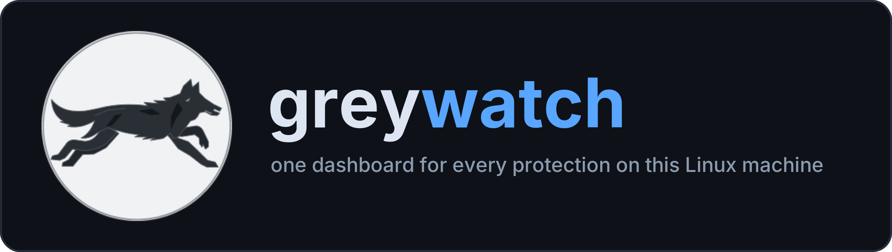

<div align="center">
  

  **One window for every security tool already on your Linux desktop.**

  [](LICENSE)
  [](https://github.com/greyok00/greywatch/releases)
  [](pyproject.toml)
  [](#build-and-test)
  [](https://github.com/greyok00/greywatch/actions)
</div>

---

## What is GreyWatch?

GreyWatch collects the security tools already installed on a Debian-based desktop (antivirus, rootkit scanner, integrity check, firewall, audit and more) into one window. It runs their scans in order, parses every log line into a structured event, and shows the verdict a person can act on. A root daemon tails each tool's journal and log files and writes an append-only event store; the GTK4 desktop app and the `gw` command-line tool are read-only clients of that store, so the window never needs root and no scan asks for your password.

On top of the suite sits a threat hunter: a separate, unprivileged process that runs its own hunt cycles every few minutes over what is already on the machine (detections, finished scans, the Downloads folder and startup automation, browser download history, and imported HAR captures). It reports findings in plain language with a suggested next step, and hands them back to the suite rather than acting on its own. A local assistant answers questions from the same event log: the deterministic advice engine and app actions come first, and every chat-initiated action pauses at a confirm dialog and lands in the audit trail.

Endpoint Hardening checks the machine against a hardening baseline, shows the real value behind each gap, and previews every change before anything is applied. The app firewall decides per program and asks before a new connection is allowed; trusted sites, trusted programs and a learning mode are one password prompt away. Its popup always carries a picture (the destination's map, the program's icon, or a shield) and a place, names what it could not identify honestly, and can be snoozed for thirty minutes or quieted per lane from Settings.

## Features

| Feature | Where | What it does |
|---|---|---|
| Six-tab GTK4 dashboard | `ui/` | Home, Scans, Protections, Tools, Threat Hunter and Settings; two themes |
| 17 managed protections | `registry.json` | State, scans, pause/resume for ClamAV, rkhunter, Lynis, AIDE, YARA, UFW, fail2ban, AppArmor, auditd, Tetragon, arpwatch and the suite's own tools |
| Root event daemon | `greywatch_daemon.py`, `collectors.py`, `parsers.py` | Bounds-checked, append-only, root-owned event store with severity and NIST CSF enrichment |
| Threat hunter | `hunter/` | Rule-based findings with plain-language explanations, an optional bounded AI explainer, HAR analysis, keep/dismiss ledgers |
| App firewall | `appfw/` | Per-program allow/deny over nftables and NFQUEUE, ask-first prompts, learning and whitelist modes, fail-open worker recovery |
| Endpoint hardening | `hardening/`, `wizard/` | Baseline checks, previews, staged apply, undo, journal |
| Local assistant | `assistant/`, `ui/assistant.py` | Deterministic advice engine first; optional small local chat model; confirm-dialog actions, audit trail |
| Self-healing | `selfheal.py`, `supervisor.py` | Diagnoses a stopped protection, applies the least invasive fix, verifies it |
| `gw` CLI | `cli.py` | `status`, `events`, `log`, `decisions`, `hunter`, `doctor`, `setup` over the same store |

## Install

Debian 13, Parrot 7.4 and Ubuntu 25.10 (Python 3.13): download `greywatch_0.1.22_amd64.deb` from the [releases page](https://github.com/greyok00/greywatch/releases) and install it:

```bash
sudo apt install ./greywatch_0.1.22_amd64.deb
```

Each release includes a `sha256` checksum. The package installs under `/opt/greywatch`, enables `greywatch.service`, binds the service to your desktop account and adds the menu entry. State (events, scans, logs) lives in `/var/lib/greywatch`; `sudo apt remove greywatch` keeps it.

For a full-system install from a checkout:

```bash
git clone https://github.com/greyok00/greywatch.git
cd greywatch
sudo ./install.sh          # installs under /usr/lib/greywatch
sudo ./install.sh --check  # verify
```

For the command line only, the wheel from a release gives you the `gw` command:

```bash
pip install https://github.com/greyok00/greywatch/releases/download/v0.1.22/greywatch-0.1.22-py3-none-any.whl
gw --version
```

## Build and test

```bash
python3 -m pytest tests/ -q
ruff check .
python3 packaging/build-wheel.sh    # py3-none-any wheel + `gw` entry point
```

## Credits

- The bundled world map in `assets/maps/world.png` is a crop of the [Natural Earth](https://www.naturalearthdata.com/) land map, which is public domain.
- All other code and assets are original to this repository.

## License

Apache 2.0. Source, issues and releases: [github.com/greyok00/greywatch](https://github.com/greyok00/greywatch).

Development: built with AI assistance and verified by tests and CI.

Privacy: everything stays on your computer. No cloud, no account, no telemetry; the event store is root-owned and the assistant answers from local logs.
