# GreyWatch Walkthrough

**GreyWatch 0.2.0 - Linux endpoint security.** One dashboard for every
protection already on this computer. The protections do their own work in the
background; GreyWatch reads what they report, explains it in plain words, and
asks you for an answer whenever something needs a decision.

This guide walks through every page and every button, including what happens
when things are missing or fail. It was written against the real running
application, verified screen by screen.

---

## 1. Start here

**What GreyWatch is.** A dashboard plus a helper service. The helper service
(the **daemon**, running as root) starts and watches the protection tools,
writes their events to `/var/lib/greywatch`, and answers requests from the
dashboard. The dashboard (this app) reads those files and never changes your
system by itself: every state-changing action is written as a request the
daemon performs, after you confirm it and, once, after a password prompt.

**Where its records live.** `/var/lib/greywatch` (system state, written by
the daemon) and a user settings file for the look and feel. Nothing you
cannot read: every record is plain JSON or plain text.

**Fail-safes, in one list:**

- **Nothing happens without a confirm.** Every button that changes the
  machine (lift a block, clear the log, secure-wipe, restore) opens a dialog
  first that names the exact command. Cancel is always available, and only
  pressing the confirm runs the command.
- **Privileged actions go through one door.** Requests the daemon must make
  as root are run by GreyWatch's helper under the system's policy agent, so
  you see a password prompt naming GreyWatch - never a bare terminal command.
- **A stale status is announced, never hidden.** If the daemon has not
  reported for too long, the app says so on screen (Settings > Diagnostics
  shows the age and the sentence "STALE: the daemon pipeline may be wedged")
  and offers Re-check.
- **A missing record is a quiet placeholder, not a crash.** Empty watchlist,
  empty lanes, empty quarantines all show a one-line "nothing yet" sentence.
- **An unreadable result never reads as safe.** A protection that has never
  reported, or whose report could not be read, is shown as UNKNOWN - not
  green.
- **Every run is traceable.** Scans, quarantine moves, lifts, and your
  answers are all appended to the Activity Log, and you can copy any row.

**Where to start in the app.** Open **Overview** (the first sidebar entry).
It always answers three questions: what is blocked, what is pending your
answer, and what each lane of tools reported last.

---

## 2. The window at a glance

The left sidebar carries the six pages, top to bottom:

| Sidebar entry | What it is |
|---|---|
| **Overview** | Counts, advisories, the two event lanes, the assistant, the action gate |
| **Firewall** | Pending decisions, network armor, the block list, the Patch the Planet watchlist |
| **Services** | Scans, findings, scanner dossiers, the service healer, the tools table, the registry |
| **Activity Log** | Security events, your recorded decisions, active quarantines, full history |
| **Settings** | Nine panes: looks, app firewall, notifications, connections, this computer, diagnostics, updates, trusted sites, trusted programs |
| **Help** | Using it, what each protection does, ten questions, terminal, about |

The header, top right, carries two controls:

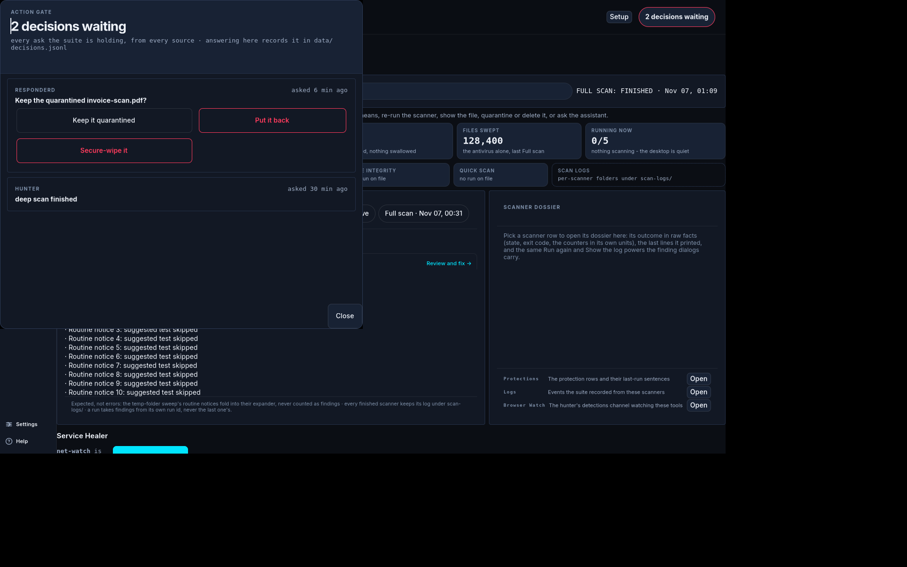

- **Setup** - the guided walkthrough of every protection, for a first run or
  a re-check.
- **The red pill, "N decisions waiting"** - the total count of questions the
  suite is holding that you have not answered. Click it: a window opens that
  lists every pending decision, each with the same answer buttons the popups
  show. When nothing is pending the sidebar's Firewall badge is absent and
  the pill disappears.

**The Firewall badge.** The small red dot on the Firewall sidebar entry
counts what needs you: pending decisions plus current blocks.

---

## 3. Overview

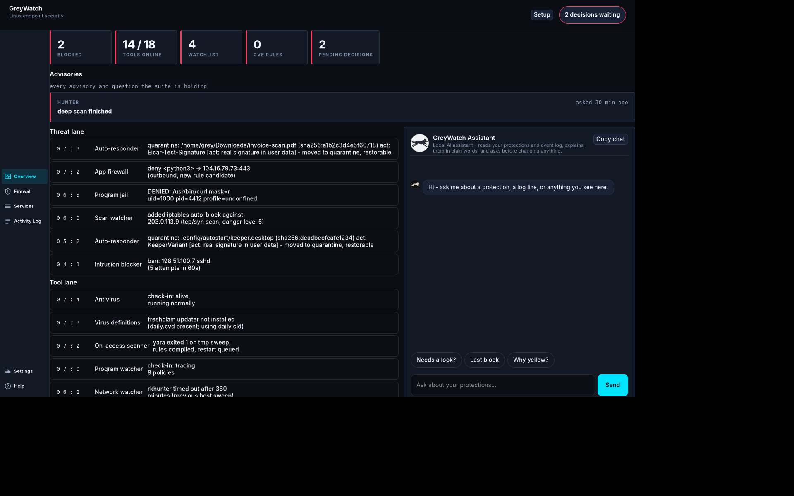

The anchor page. From top to bottom:

1. **The ribbon** - five cards: **Blocked** (active IP blocks), **Tools
   online** ("14 / 18"), **Watchlist** (projects on the Patch the Planet
   watchlist, or "not read"), **CVE rules** (known-flaw rules loaded), and
   **Pending decisions** (the same count as the header pill).
2. **Advisories** - every advisory and question the suite is holding, as
   cards (for example "HUNTER - deep scan finished - asked 35 min ago").
3. **Threat lane** and **Tool lane** - two feeds of recent events. Threat
   lane rows are things that need an owner's judgement (quarantines, denies,
   bans); tool lane rows are the protections' own check-ins and notes. Every
   friendly tool name (Auto-responder, Program jail, Scan watcher, ...) has
   its real name behind it, one click away in Help > Security Tools.
4. **The metadata card** - click any row: the card appears right below the
   lanes and scrolls into view, so a click always reads. Threat rows offer
   that lane's controls on the card; tool rows carry only **Copy details**.
   Both lanes carry a quiet jump link - **Open Services** for tool events,
   **Open Firewall** for threat events - so you land on the page that owns
   that event.
5. **The assistant** - the terminal on the right. Type a question about a
   protection, a log line, or anything on screen; the assistant reads your
   event log and protections and answers in plain words. **Copy chat** puts
   the whole conversation on the clipboard.
6. **The action gate** - the pending questions' answer rows, bottom of the
   page: each with its option buttons (keep, restore, wipe, note), a running
   sentence while the helper works, and an exit-code sentence if it does not
   finish, plus a try again.

**Copy details** puts a plain-text digest on the clipboard
(severity, tool name and id, the raw line). If the desktop clipboard is
unavailable the button simply does nothing - the event is never lost
either way, it stays in the log.

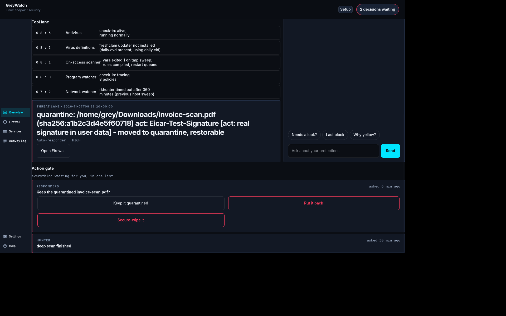

---

## 4. Firewall

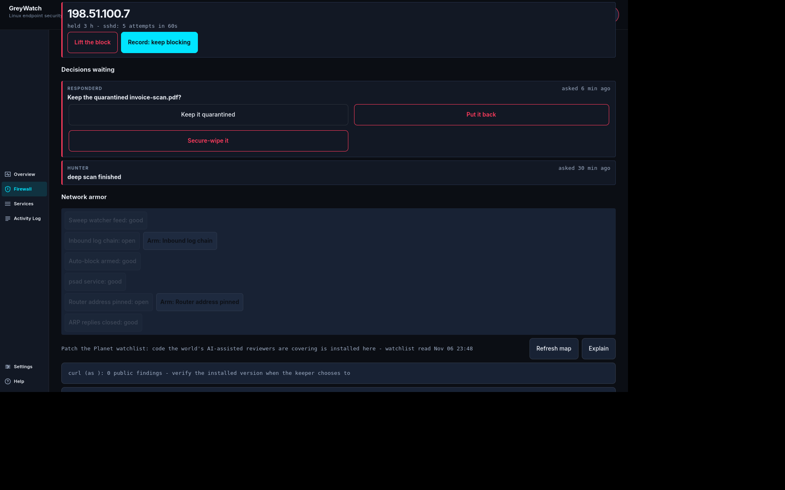

The page that owns blocking, decisions, and the network. Top to bottom:

**Pending decisions.** Each open question is a card, newest first, with the
age ("asked 11 min ago") and its option buttons:

- **Keep it quarantined** - the file stays in quarantine. Safe default; you
  decide later.
- **Put it back** - restores the file to where it came from. If you did not
  cause the file, pick this only if you recognise it.
- **Secure-wipe it** - overwrites and deletes the quarantined file. Shown in
  the danger colour; a confirm dialog names the exact command before
  anything runs.

Each answer is recorded once to the decisions log, so a question you have
answered never reappears.

**Network armor.** One line per protection state: "Sweep watcher feed:
good", "Auto-block armed: good", "psad service: good", "ARP replies closed:
good" - and two tiles that can be open: **Inbound log chain** and **Router
address pinned**. When a tile reads "open", an **Arm: ...** button sits next
to it; pressing it requests the change (with its confirm dialog). When a
tile reads "good" there is nothing to do, and the button is absent.

**The block list.** Current IP blocks as cards: address, how long it has
been held, the source protection and reason, and two actions:
**Lift the block** (opens the confirm dialog - "lift-block 203.0.113.9 /
You will be asked for your password." - and Cancel keeps the block) and
**Record: keep blocking**, which writes your decision to keep the block into
the decisions log, so the question stops counting as waiting without
touching the firewall.

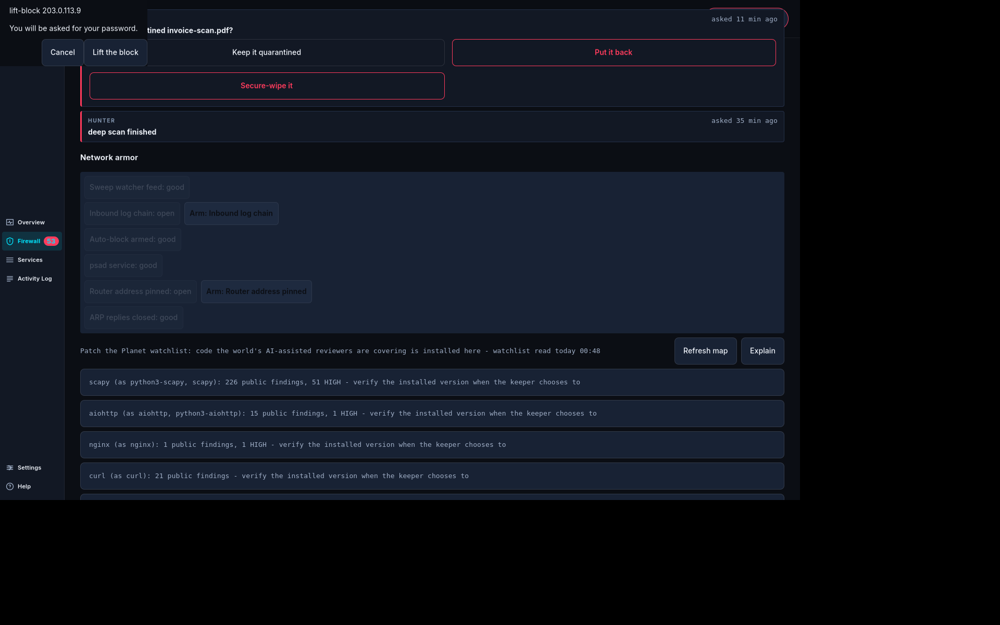

**Patch the Planet watchlist.** "Code the world's AI-assisted reviewers are
covering is installed here." Rows name each watched project with its
installed names, its public finding count, and the HIGH count - for example
"scapy (as python3-scapy, scapy): 226 public findings, 51 HIGH - verify the
installed version when the keeper chooses to". Press **Refresh map** to
re-read the watchlist now; the stamp on the left says when it was last read.
Press **Explain** to ask the assistant for the watch table in plain words.
A project row opens its drill-down (what the public findings are and which
installed package they map to); close it when done.

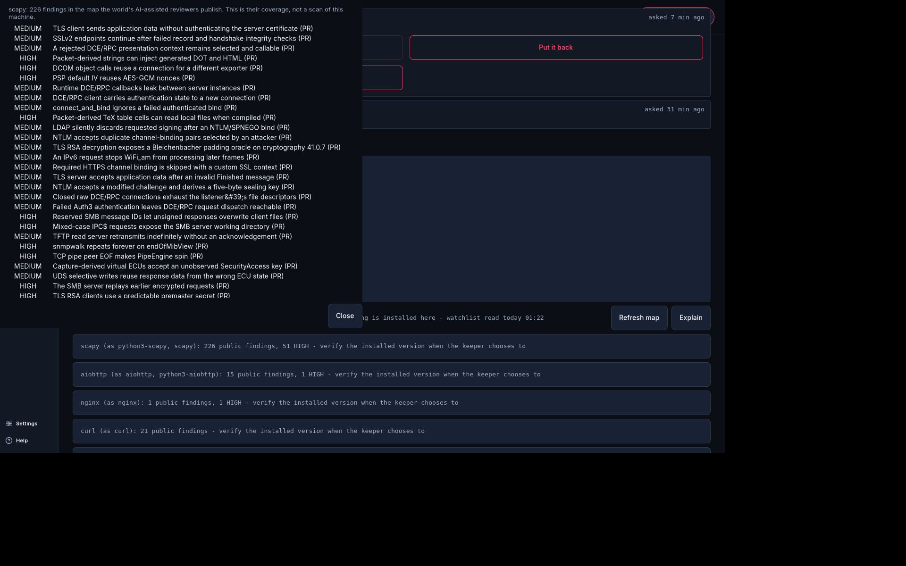

**Failsafes on this page.** If the watchlist has never been read, the
Overview tile says "not read" and the section stays empty instead of
inventing numbers; Refresh map fills it. If a project's installed packages
cannot be resolved, the row degrades to the project name alone. Blocks are
kept in the blocked-IP ledger (including releases, so you can see what was
lifted and why); the ledger is on this page below the rows.

---

## 5. Services

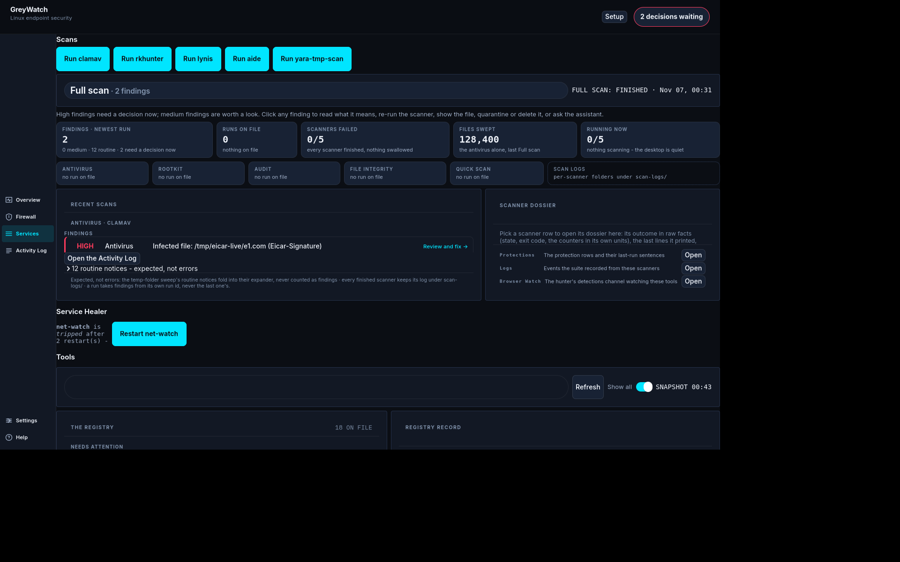

Everything about scanning and the tools themselves.

**The scan run header.** A **Live** pill (the current run) and one pill per
past run ("Full scan - Nov 07, 00:31"). The banner reads
`FULL SCAN: FINISHED - Nov 07, 00:31` or `RUNNING` while scanners work.

**The stat tiles.** **Scanners failed** (0/5, "every scanner finished,
nothing swallowed"), **Files swept**, **Running now** (0/5, "nothing
scanning - the desktop is quiet"), plus buttons **File integrity**, **Quick
scan**, and **Scan logs** ("per-scanner folders under scan-logs/").

**Findings.** The run's findings, most severe first, one row per finding:
severity chip (HIGH etc.), the tool ("Antivirus"), the raw line, and
**Review and fix >**. Pressing it opens the finding dialog, which explains
the line in plain words: what the line is, what it means ("why it matters"),
and "what to do" - then the actions: **Copy details**, **Run <tool> again**,
**Quarantine file**, **Delete file**, **Ask the assistant**, and **Close**.
Quarantine and Delete open their own confirm dialogs before anything runs.

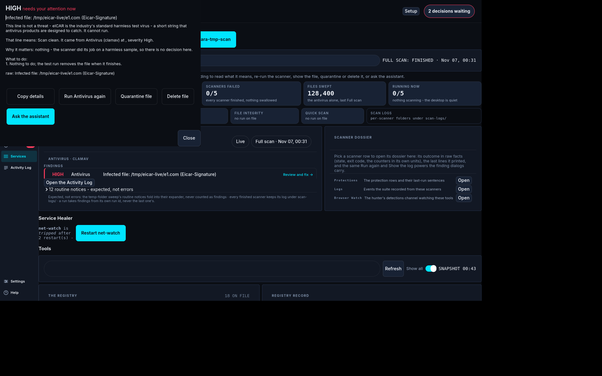

**Routine notices.** The expander under the findings ("12 routine notices -
expected, not errors") folds away the scanner notices that are expected and
never counted as findings. Click it to open or close. Its caption explains
itself: routine notices fold into their expander, every finished scanner
keeps its log under scan-logs/, and a run takes findings from its own run id,
never the last one's.

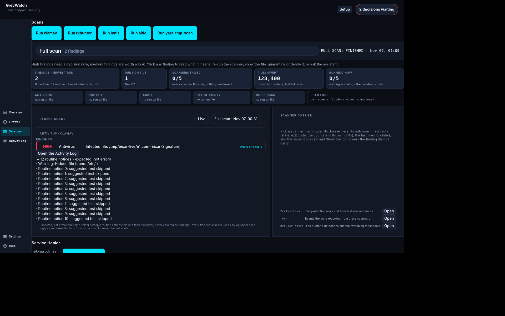

**The scanner dossier.** "Pick a scanner row to open its dossier here: its
outcome in raw facts (state, exit code, the counters in its own units), the
last lines it printed, and the same Run again and Show the log powers the
finding dialogs carry." Three quick links on the right: **Protections**
(the tool rows and their last-run sentences), **Logs** (events the suite
recorded from these scanners), **Browser Watch** (the hunter's detections
channel).

**The record.** **Open the Activity Log** - every scan event, with a fix
card per row.

**Service healer.** When a protection is tripped after its restarts, the
healer says so ("net-watch is *tripped* after 2 restart(s)") and offers
**Restart net-watch** - a request the daemon performs, with its confirm.

**The tools table.** Every protection as a row: state chip, last-run
sentence, its Pause/Resume and controls (two-lane law: tool controls live
here, never next to threat rows). **Refresh** re-reads now; **Show all**
toggles hidden/dormant tools into the table; the **SNAPSHOT** stamp right of
the switch shows the data's age. Selecting a row opens its dossier panel,
which carries **Open the Activity Log**.

**The registry.** "THE REGISTRY - 18 ON FILE" beside the **REGISTRY RECORD**:
the full list of protections GreyWatch knows, with where each one's state
lives.

**Failsafes on this page.** If the daemon is absent, a scan press still
works: the request is written to a request file the daemon honours (one
validated key, written atomically so a half document is never read), the
action is recorded in the audit trail, and the page jumps there so you can
watch - and then nothing pretends to run. The RUNNING NOW tile keeps its
truthful count and the banner keeps its last real state, so a run that never
started is never reported as started or finished. When the service returns,
it picks the request up.
File integrity and quick scan show "no run on file" until their first run.
If a scanner was skipped ("no baseline"), the tile says so plainly.

---

## 6. Activity Log

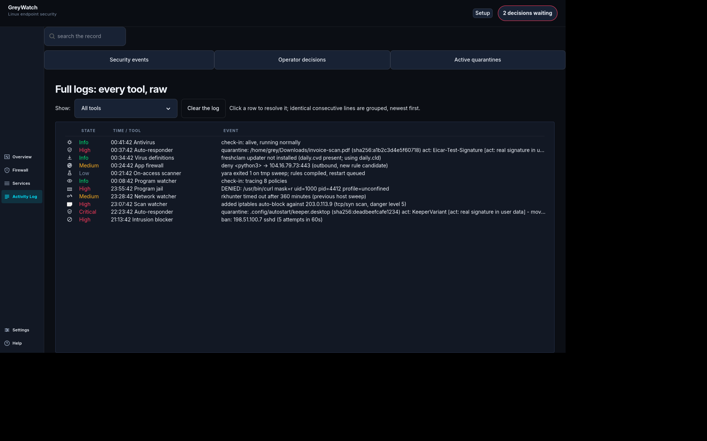

Three tabs plus the full trail:

| Tab | What it lists | What you can do per row |
|---|---|---|
| **Security events** | The events the protections reported, newest first | Click to open the fix card (details copy, lane actions, jump to Firewall or Services); identical consecutive lines are grouped |
| **Operator decisions** | "Every answer on record, newest last": what you answered, when, and with which option | The history of your own answers |
| **Active quarantines** | "N quarantine record(s) on file": original path, detection tag, time, sha256 tag, and the quarantine file | The lifecycle on each record: **Keep quarantined**, **Put it back**, **Secure-wipe** (the danger tone) - each behind its own confirm dialog |

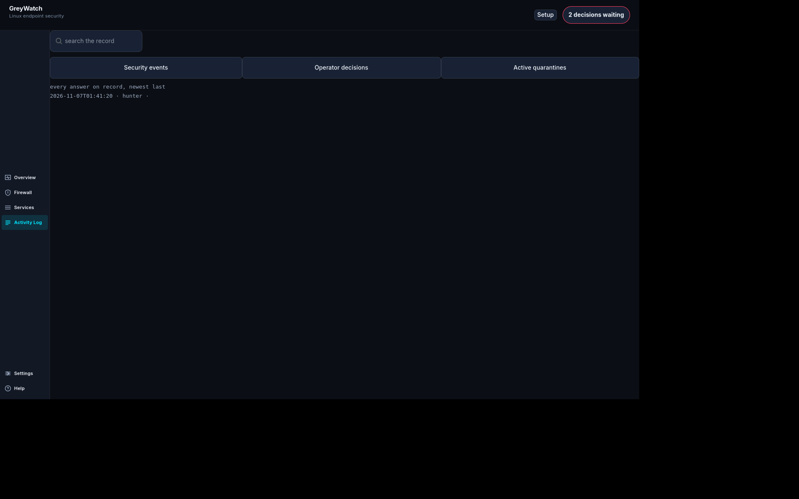

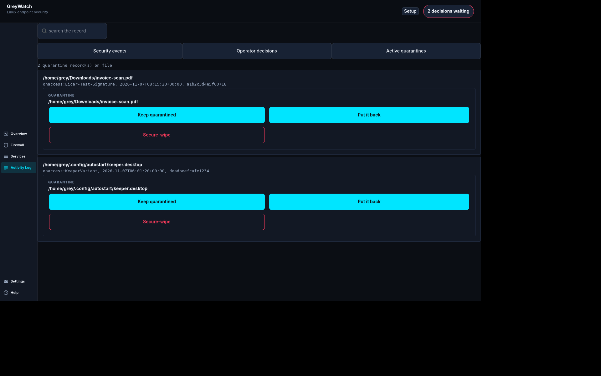

**Clear the log** erases the event trail - behind its own confirm dialog;
press **Cancel** and nothing changes.

**Reading habits the page enforces.** The status line says it: "Click a row
to resolve it; identical consecutive lines are grouped, newest first."
Tooltips on rows carry the full text so nothing is clipped; a search box
("search the record") narrows the trail, and a tool picker (Show: All tools)
narrows it to one protection.

**The full log view.** Settings-adjacent folder and trail views ("Open the
Activity Log" buttons route here from every page that mentions logs) - the
same trail, one page, one click away.

---

## 7. Settings

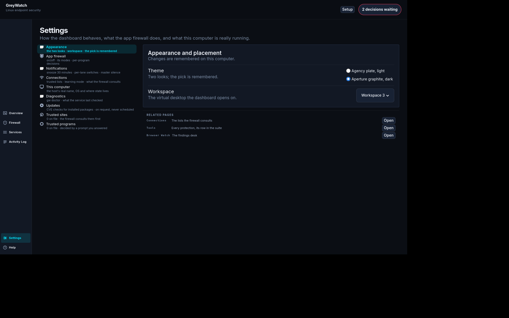

Nine panes in the left index. Each pane ends with **RELATED PAGES** links
that jump across the app.

- **Appearance and placement** - two looks: **Agency plate, light** and
  **Aperture graphite, dark**; the pick is remembered on this computer and
  restored on the next launch. **Workspace** chooses the virtual desktop the
  dashboard opens on (1 to 6).
- **App firewall** - the on/off button ("Turn on"), the note of what it
  decided so far, and **Learning mode** with its duration (15 minutes, one
  hour, eight hours, or until you stop it): while learning, the firewall
  records what programs try instead of blocking them.
- **Desktop notifications** - the master switch ("The total switch: off
  silences every lane at once"), **Snooze 30 minutes** ("then they come back
  by themselves"), plus per-lane switches: **Firewall deny popups** and
  **Critical event popups**. "Scans and events stay recorded even when their
  popups are quiet."
- **Connections seen while learning** - the learned list with **Trust this
  program**, **Trust this site**, **Block this site**, **Clear**. With
  nothing learned yet the buttons are greyed out and the pane says "Nothing
  learned yet. Turn learning on under App firewall." Trusting one here is
  the same answer the popup would have offered.
- **This computer** - the host's real name, the OS, and where the state
  files live.
- **Diagnostics** - the gw doctor output: the service's MainPID and
  ActiveState, the status snapshot age, and the STALE sentence when the
  daemon has not reported in a while ("the daemon pipeline may be wedged -
  restart it"), with **Re-check** to re-read right now.
- **Updates** - CVE checks for installed packages, on request, never
  scheduled.
- **Trusted sites** - the list the firewall consults first, with its count
  shown in the index.
- **Trusted programs** - "These connect without asking. Pick from the list,
  or browse for the program you mean": a program picker, **Browse...**, and
  **Trust program**; **Remove program** takes one out. Empty state: "Nothing
  trusted yet. Programs you trust appear here."

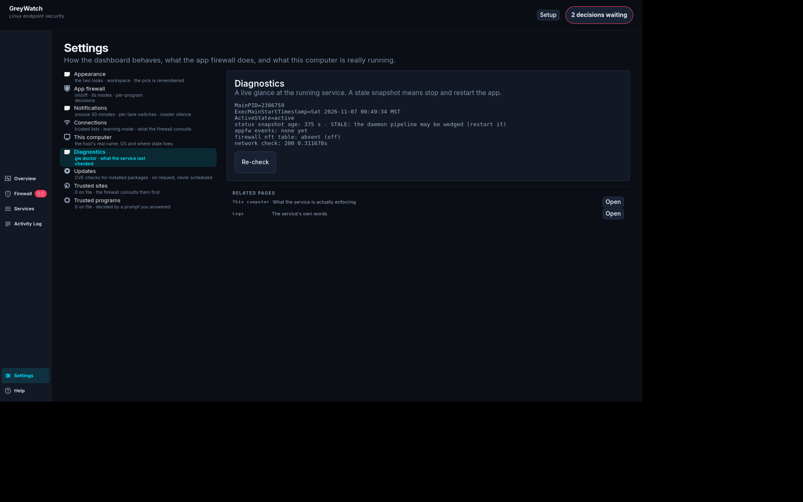

---

## 8. Help

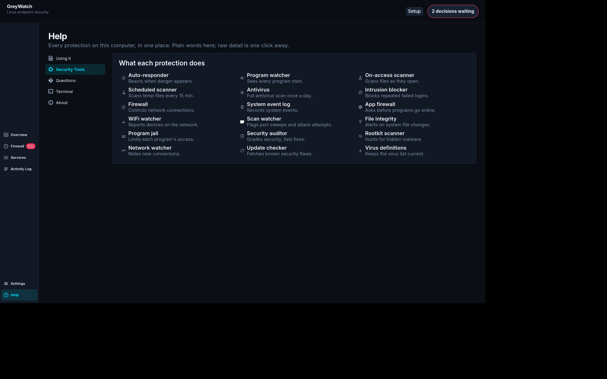

Five subpages, plain words, no jargon:

- **Using it** - the orientation: which page owns which question.
- **Security Tools** - "What each protection does": all eighteen, one line
  each (Auto-responder - reacts when danger appears; Program watcher - sees
  every program start; On-access scanner - scans files as they open;
  Antivirus - full scan once a day; Firewall - controls network
  connections; App firewall - asks before programs go online; Program jail -
  limits each program's access; File integrity - alerts on system file
  changes; Rootkit scanner - hunts for hidden malware; Integrity blocker,
  Intrusion blocker - blocks repeated failed logins; Scan watcher - flags
  port sweeps and attack attempts; Security auditor - grades security and
  lists fixes; Scheduled scanner - scans temp files every 15 min; System
  event log - records system events; Network watcher - notes new
  connections; WiFi watcher - reports devices on the network; Update checker
  - fetches known security flaws; Virus definitions - keeps the virus list
  current).
- **Questions** - the ten things owners ask most, each answered in one
  sentence (What does GreyWatch do; How do I pause a protection; A detection
  appeared - what now; How do I change the theme; Is my disk encrypted; How
  do I run a scan; What does "At risk" mean; How do I isolate my machine;
  Why is my antivirus quiet; How do I undo a wizard change).
- **Terminal** - what to run when you want the raw view without the window.
- **About** - the version, the one-paragraph promise (protections watched,
  event trail stays on this machine, the assistant's answers composed from
  your own logs by a model that runs on your own CPU), and the
  **Source and releases** link.

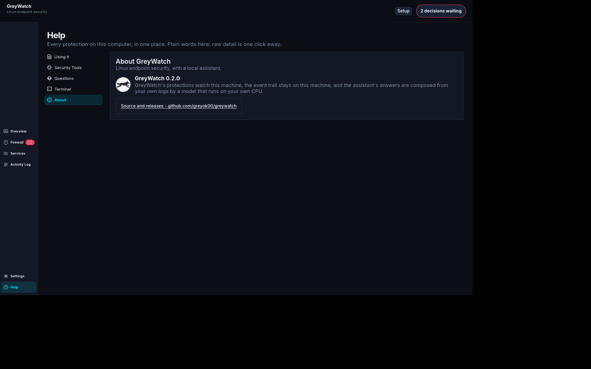

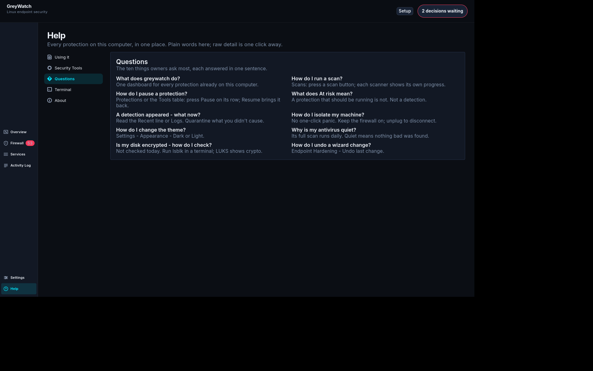

---

## 9. The assistant

The assistant terminal (Overview, right side; also reachable from finding
dialogs with **Ask the assistant**) is the local chat brain: it reads the
same published records the pages read, explains a line in plain words, and
can run only the same manual paths the buttons carry (whitelisted intents +
the audit trail), never its own inventions. If a reply fails, the panel
offers **Retry** - the question is kept, nothing is lost; **Copy chat**
keeps the transcript.

---

## 10. FAQ

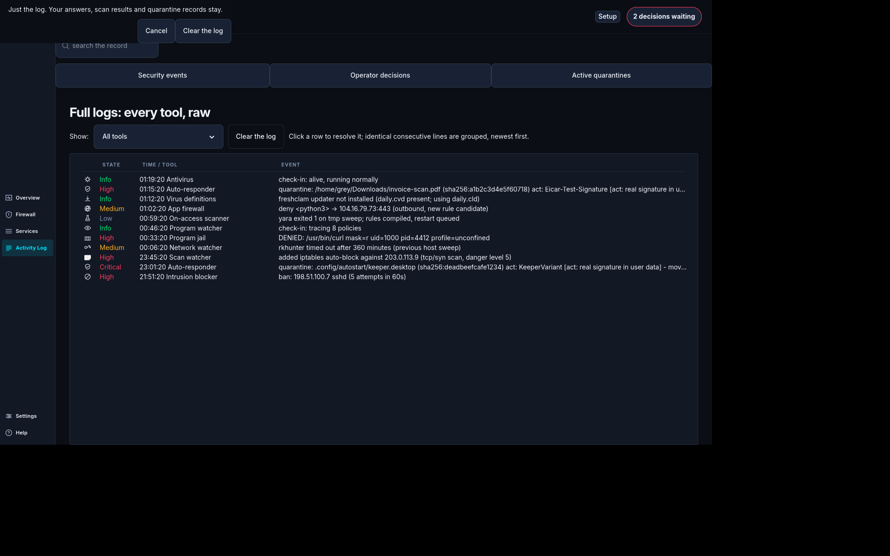

**Is anything sent anywhere?**
No. The event trail stays on this machine. The assistant's answers are
composed on this machine, by a model that runs on your own CPU.

**Something needs a decision. Where do I answer it?**
Three doors lead to the same answers: the header pill ("N decisions
waiting"), the Firewall page's decision cards, and the action gate at the
bottom of Overview. Answering with any door records it once.

**I pressed a row and nothing seemed to happen.**
Look just below the lanes: the metadata card paints there and the page
scrolls it into view. If you still see nothing, the row you pressed had
already been replaced by a newer paint (the feeds refresh on their own);
press it again.

**A scan press did nothing - the scanner never started.**
The request was written, but the helper service is not running to perform
it. Check Settings > Diagnostics: it shows whether the service is active
and how old its last report is. Start the service, then press the scan
again; the request the app wrote is safe to repeat and never runs twice.

**Something says "At risk". What does that mean?**
It is the colour a protection carries when it should be running but is not.
It is not a detection - it means "look at this row".

**A HIGH finding appeared. What now?**
Open Services, press **Review and fix** on the row. The dialog explains the
line in plain words, tells you why it matters and what to do, and carries
the actions (copy, run again, quarantine, delete, ask the assistant). If you
did not cause the file, quarantine is the safe move: the file leaves its
place but is not destroyed, and you can restore or secure-wipe it later from
the Active quarantines tab.

**Something keeps asking for my password. Is that the app?**
Privileged requests all go through one helper under the system's policy
agent; the prompt names GreyWatch and the command it wants to run. If a
prompt names something else, cancel it and check Diagnostics.

**How do I pause a protection?**
Services > the tools table: Pause on its row. Resume brings it back. The
row's state chip will read what happened.

**How do I undo a change I made in the wizard?**
Help > Terminal explains the undo path; Settings keeps your picks
remembered, and every change you confirmed is recorded in the Operator
decisions tab of the Activity Log.

**The status looks frozen.**
Settings > Diagnostics: if the snapshot age reads STALE, press **Re-check**.
If it stays stale, the daemon pipeline may be wedged - restart the service,
and the app will recover its view by itself.

**Can I get the raw lines without the window?**
Yes. Help > Terminal lists the file paths and commands: the event trail
under `/var/lib/greywatch` is plain JSON Lines you can read with any tool.

**Why does the watchlist say "not read"?**
The Patch the Planet map has not been read on this machine yet. Press
**Refresh map** on the Firewall page and it fills in; the stamp shows when.

**What happens on a machine with no desktop notifications?**
Nothing breaks: the switches stay off, events stay recorded, and the
counters keep counting. Popups are a convenience lane, never the record.

---

*This guide describes GreyWatch 0.2.0 exactly as shipped. Every claim above
was checked against the running application screen by screen; screenshots in
the shots folder show each step.*
